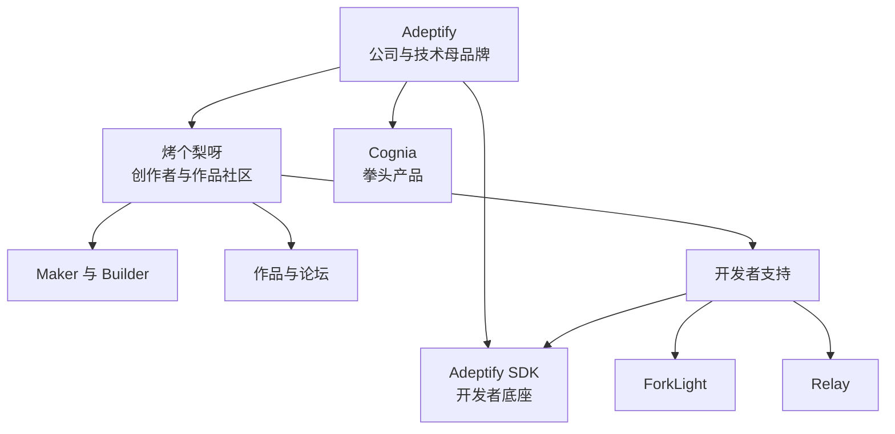
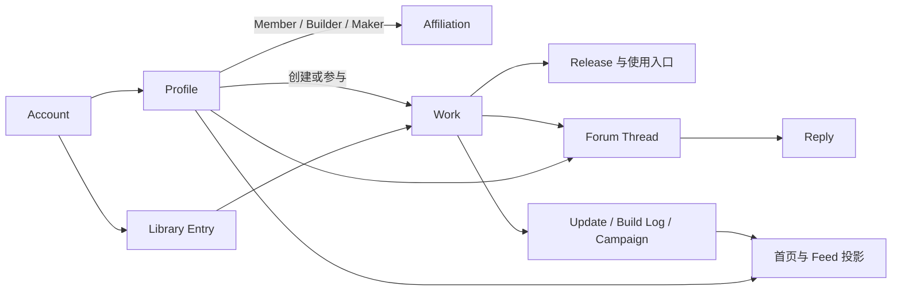
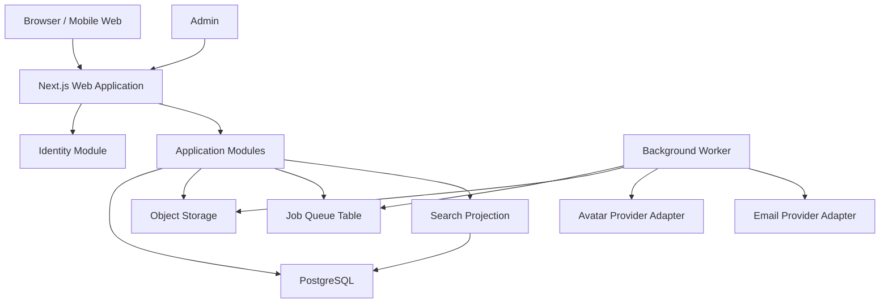

# 烤个梨呀产品设计与技术迭代计划

版本：v0.1  
日期：2026-07-27  
状态：产品与技术对齐稿  
上游文档：[Adeptify 团队运营、品牌推广与社区生态商业计划书](./2026-07-25-adeptify-ecosystem-business-plan.md)  
适用范围：烤个梨呀首页、创作者与作品目录、论坛、开发者中心、账号与 Builder 入驻、漫画头像、轻量作品分发

> 本文是战略母文档的下游产品与实施计划。战略方向、信任边界和证据门继续以上游文档为准；页面范围、账号、论坛和开发者中心以 2026-07-27 之后确认的最新决定为准。

---

## 目录

- [Executive Summary](#executive-summary)
- [1. 已确认的产品决策](#1-已确认的产品决策)
- [2. 产品目标、用户与非目标](#2-产品目标用户与非目标)
- [3. 核心产品模型](#3-核心产品模型)
- [4. 信息架构与路由](#4-信息架构与路由)
- [5. 页面产品设计](#5-页面产品设计)
- [6. 关键用户流程](#6-关键用户流程)
- [7. 漫画头像系统](#7-漫画头像系统)
- [8. 视觉与交互系统](#8-视觉与交互系统)
- [9. 技术架构](#9-技术架构)
- [10. 模块边界](#10-模块边界)
- [11. 数据模型草案](#11-数据模型草案)
- [12. 权限、审核与社区治理](#12-权限审核与社区治理)
- [13. 安全、隐私与下载信任](#13-安全隐私与下载信任)
- [14. 搜索、发现与通知](#14-搜索发现与通知)
- [15. 指标与证据](#15-指标与证据)
- [16. 测试与质量门](#16-测试与质量门)
- [17. 技术迭代计划](#17-技术迭代计划)
- [18. V1 Launch 内容清单](#18-v1-launch-内容清单)
- [19. 主要风险与控制](#19-主要风险与控制)
- [20. 实施任务板种子](#20-实施任务板种子)
- [21. 开发前仍需确认的事项](#21-开发前仍需确认的事项)
- [22. Definition of Done](#22-definition-of-done)

---

## Executive Summary

### 产品是什么

烤个梨呀是由 Adeptify 发起的 AI 创作者、作品和早期用户社区。

它同时提供四种连续价值：

1. 通过有趣的首页认识正在创造的人和真实作品；
2. 通过创作者主页和作品页发现、下载、使用或申请体验 AI 应用；
3. 通过论坛围绕具体作品交流、测试、反馈和共同解决问题；
4. 通过开发者中心使用 Adeptify SDK、ForkLight、Relay 等开发能力。

“AI 应用的 Steam”是内部机制北极星，提醒产品长期需要具备创作者主页、作品详情、使用与下载、Library、更新、社区 Hub、开发工具和分发能力。烤个梨呀不复制 Steam 的视觉、商业结构或排行榜逻辑，也不退化为 AI 产品目录。

### 第一版要跑通的闭环

```text
外部 Builder 注册
-> 建立创作者 Profile
-> 上传照片并生成漫画头像
-> 提交作品
-> 通过基础审核进入公开目录
-> 发布测试招募或 Build Log
-> 用户使用作品并在论坛反馈
-> Builder 回应并更新作品
-> 更新重新出现在首页、作品页和创作者页
```

### Design Read

这是一个面向 Maker、Builder、产品用户和开发者的综合社区。首页与公开目录采用“漫画人物 + 独立杂志 + 开放工作室”的视觉语言；论坛、账号和管理界面采用清晰、克制、可长期使用的社区产品语言。

设计参数：

- `DESIGN_VARIANCE: 8`
- `MOTION_INTENSITY: 5`
- `VISUAL_DENSITY: 5`

---

## 1. 已确认的产品决策

### 1.1 品牌关系



- Adeptify 是公司名和技术母品牌；
- 烤个梨呀是社区名；
- `Adeptify SDK` 始终使用完整名称，避免与公司主体混淆；
- Cognia 是拳头产品，在首页和作品体系中拥有更高叙事权重；
- ForkLight、Relay、马哥的馊主意等保持独立产品身份；
- 烤个梨呀负责连接、策展和社区关系，不默认拥有外部 Builder 的作品。

推荐的品牌署名：

> 烤个梨呀，由 Adeptify 发起。

### 1.2 人与身份

- Maker 与 Builder 使用同一种公开 Profile 和同一个创作者目录；
- `Maker` 是 Adeptify 团队关系，由管理员授予；
- `Builder` 是外部创作者关系，注册并完成入驻后获得；
- 普通注册用户为 `Member`，可以使用、关注、发帖和反馈，但不自动进入创作者目录；
- 一个人可以同时是其他作品的用户、测试者或共创参与者。

首批 Adeptify Makers：

- 马哥
- 徐晶（果果）
- 谢俊（俊仔）
- 庄昊哲（哲子）
- 杨鹏飞（飞哥）

正式上线前补齐每位 Maker 的真实介绍、兴趣、作品关系和公开边界，不编造职位、经历或人格标签。

### 1.3 最新决定对原第一阶段范围的扩展

战略母文档原本将完整账号、开放 UGC 和社区产品放在证据门之后。最新决定明确将以下能力纳入烤个梨呀 V1：

- 用户注册和登录；
- 外部 Builder 入驻；
- 公开论坛；
- 人与作品统一发现；
- 作品下载、使用和开发者支持。

因此本计划以“受控开放”替代“完全延后”：普通用户可以开放注册；Builder 公开入驻、作品公开和高风险内容仍需基础审核；论坛从最小但完整的交流闭环开始，不在 V1 建设私信、等级、排行榜和实时聊天室。

---

## 2. 产品目标、用户与非目标

### 2.1 产品目标

第一阶段需要证明：

1. 用户会因为某位创作者或某件作品进入烤个梨呀；
2. 用户能顺畅下载、使用、安装或申请体验作品；
3. 创作者能持续展示作品，而不是完成一次性自我介绍；
4. 论坛讨论能与具体作品、版本、测试或开发问题发生关系；
5. 用户会跨创作者、跨作品返回；
6. Adeptify 的开发工具能被真实 Builder 发现、理解和采用。

### 2.2 主要用户

| 用户 | 主要任务 | 产品提供的价值 |
|---|---|---|
| 访客 | 找到有趣或有用的 AI 应用 | 首页策展、作品介绍、直接使用或下载 |
| Member | 讨论、反馈、关注和管理使用关系 | 论坛、关注、Library、通知 |
| Builder | 展示作品、找用户、获得反馈和技术支持 | Profile、作品集、发布、论坛、开发者中心 |
| Maker | 持续呈现个人判断、作品和变化 | Maker Album、作品集、Build Log、长期故事线 |
| 开发者 | 使用 SDK、工具和示例 | 文档、安装、版本、支持论坛 |
| 运营与管理员 | 策展、审核、纠错和维护社区秩序 | Admin、审核队列、举报、内容状态和审计记录 |

### 2.3 V1 非目标

- 不做支付、结算和完整商业分成；
- 不做统一应用安装器和自动更新器；
- 不做面向第三方 App 的完整 SSO；
- 不做无限开放的产品自荐广场；
- 不做星级评价和单一下载量排行榜；
- 不做私信、实时群聊、复杂等级和勋章体系；
- 不把所有内部能力包装成已经成熟的公共 SDK；
- 不把友好社区反馈当作市场验证。

---

## 3. 核心产品模型

### 3.1 关系模型



### 3.2 作品类型

| 类型 | 含义 | 首批种子 |
|---|---|---|
| Flagship Product | 当前重点投入和叙事的拳头产品 | Cognia |
| App | 用户可以直接获得独立价值的应用 | 马哥的馊主意 |
| Builder Tool | 帮助 Builder 制作或运营作品的工具 | ForkLight、Relay |
| SDK / Capability | 可集成的开发能力 | Adeptify SDK |
| Experiment | 已可体验但仍在验证的实验 | 后续真实项目 |

作品类型只决定展示和使用方式，不代表质量高低。

### 3.3 作品成熟度

公开状态使用真实、可解释的词：

| 状态 | 含义 | 可以出现的主动作 |
|---|---|---|
| Internal | 内部使用，尚未开放 | 关注后续 |
| Recruiting | 正在寻找种子用户或测试者 | 申请体验 |
| Testable | 已有可用版本，但仍在验证 | 开始体验 / 下载 |
| Public Beta | 已公开，兼容和支持边界仍有限 | 使用 / 安装 / 查看文档 |
| Stable | 有明确发布、兼容和支持方式 | 使用 / 下载 / 安装 |
| Paused | 暂停投入，但保留历史 | 查看后续 |
| Archived | 已结束或被替代 | 查看完整故事 |

状态由作品 Owner 或管理员维护。更深技术接入不自动获得更高推荐。

### 3.4 主动作映射

每件作品只显示一个最重要的主动作，避免“下载”“立即体验”“开始使用”同时竞争。

| 交付方式 | 主动作 |
|---|---|
| Web App | 立即使用 |
| Desktop / Mobile App | 下载 |
| CLI Tool | 安装 |
| SDK | 查看文档 |
| 封闭测试 | 申请体验 |
| 暂停或归档 | 查看后来怎样了 |

“了解作品”作为次要入口，进入完整作品页。

### 3.5 作品归属与披露

每件作品必须能清楚回答：

- `Created by`：谁制作了它；
- `Published by`：由个人、团队还是 Adeptify 发布；
- `Featured in`：是否被烤个梨呀策展或收录；
- `Built with`：是否使用 Adeptify SDK 或其他能力；
- `Relationship disclosure`：是否为 Adeptify 自有、投资、合作或商业推广。

外部 Builder 的作品不得因为被收录而显示为 Adeptify 产品。

---

## 4. 信息架构与路由

### 4.1 一级导航

```text
首页
发现
论坛
开发者
关于
                         搜索  登录 / 注册
```

桌面导航保持单行，移动端折叠为简洁菜单。登录后增加头像入口，不把个人功能继续塞入主导航。

### 4.2 路由结构

```text
/
/explore
/people/:slug
/works/:slug
/feed
/forum
/forum/:categorySlug
/forum/:categorySlug/:threadSlug
/developers
/developers/adeptify-sdk
/developers/forklight
/developers/relay
/library
/account/profile
/account/creator
/account/works
/account/notifications
/join/builder
/about
/admin
```

V1 中 `/feed` 可以作为首页“正在发生”的完整列表存在，但不必进入一级导航。`/library` 登录后从头像菜单进入。

### 4.3 发现页

`/explore` 是人和作品的统一发现入口。

页面视图：

```text
全部
创作者
作品
```

“全部”视图按关系组织，而不是简单将两种卡片随机混排：

1. Adeptify Makers；
2. 最近活跃的 Builders；
3. 精选作品；
4. 正在招募体验或反馈的项目；
5. 与当前浏览内容有关的人和作品。

创作者视图支持：

- 全部、Maker、Builder；
- 关注领域；
- 当前是否有可体验作品；
- 最近更新，而不是粉丝量排名。

作品视图支持：

- 类型；
- 成熟度；
- 平台；
- 是否可立即使用；
- 是否正在招募反馈；
- 创作者。

V1 数据量较小时使用服务端查询和轻量筛选，不提前建设复杂推荐系统。

---

## 5. 页面产品设计

### 5.1 首页

#### 页面任务

让第一次访问的人在一个视口内知道：

- 这里有真实的人；
- 他们正在做真实作品；
- 作品可以使用、下载或参与；
- 这里的讨论会让作品继续变化。

#### 推荐叙事

首屏工作文案：

> 认识做东西的人，体验正在长大的作品。

补充说明工作文案：

> 这里记录 Maker 和 Builder 的作品、尝试、反馈，以及它们后来变成了什么。

首屏动作：

- 主动作：逛逛作品
- 次动作：看看谁在做

#### 页面结构

1. **漫画式工作台 Hero**
   - 左侧是品牌价值和入口；
   - 右侧使用真实漫画头像、真实产品截图或视觉资产；
   - 人物与作品可发生轻量 hover 关联；
   - 不制作由矩形拼出的假产品界面。

2. **当前主角**
   - Cognia 使用完整的大版面；
   - 讲清当前价值、真实状态和体验入口；
   - 不与所有小项目等权排列。

3. **正在发生**
   - 聚合作品更新、Build Log、测试招募、论坛回应和 After Story；
   - 初期由编辑规则和人工置顶共同决定；
   - “正在烤”可以作为一次品牌化栏目名，不扩散为整套含混状态词。

4. **认识创作者**
   - 首批 Maker 使用大幅漫画肖像和作品关系；
   - 新 Builder 使用更紧凑的列表；
   - 不使用统一圆形头像和三列简历卡片。

5. **可以立即体验的作品**
   - 每件作品展示真实截图、创作者、价值、状态和唯一主动作；
   - 混合 App、Tool 和 SDK 时通过版式和动作区分。

6. **社区正在讨论**
   - 选择与作品真实相关、已有有效交流的主题；
   - 不根据回复数自动制造热榜。

7. **Builder 工具架**
   - Adeptify SDK、ForkLight、Relay；
   - 说明各自解决的问题和成熟度；
   - 入口进入开发者中心。

8. **加入社区**
   - 注册参与；
   - 已有作品的人可以进一步申请 Builder 入驻。

#### 首页策展规则

首页不是产品数量排行榜。可采用的策展维度：

- 最近可以体验；
- 正在寻找种子用户；
- 来自同一位创作者；
- 因社区反馈发生变化；
- 暂停后重新开始；
- 使用 Adeptify SDK 构建；
- 用户跨作品反复参与。

### 5.2 创作者主页

路径：`/people/:slug`

页面结构：

1. 漫画头像、昵称、Maker / Builder 关系和一句介绍；
2. 当前关注的问题和正在制作的内容；
3. 置顶作品；
4. 全部作品集；
5. 创作时间线；
6. 最近发布、Build Log 和论坛讨论；
7. 关注创作者；
8. 经本人选择的外部链接。

作品集中的每件作品提供：

- 作品封面或真实截图；
- 一句话价值；
- 当前状态；
- 该创作者承担的角色；
- 主动作；
- 作品详情入口。

创作者主页不是简历。教育、公司和职位不是默认主结构；只有当它们帮助理解作品时才展示。

### 5.3 作品详情页

路径：`/works/:slug`

页面需要同时完成：价值理解、直接使用、信任建立、创作者连接和社区参与。

结构：

1. 作品视觉、一句话价值和唯一主动作；
2. 适合谁，在什么场景使用；
3. 截图、视频或真实演示；
4. 当前成熟度、平台和支持范围；
5. 创作者与团队关系；
6. 创作起点、关键判断和产品差异；
7. 最近更新和版本；
8. 测试、反馈或 Campaign；
9. 相关论坛讨论；
10. After Story；
11. 来自同一创作者的其他作品。

下载类作品额外显示：

- 支持平台和系统版本；
- 当前版本与发布日期；
- 文件来源与发布者；
- 安装说明；
- 文件大小和校验信息；
- 权限、数据和安全说明；
- License；
- 历史版本与更新日志。

V1 可以使用受控外部下载链接或对象存储，不建设统一安装器。

### 5.4 论坛

路径：`/forum`

首批板块：

1. 作品发布与 Build Log；
2. 找人体验与产品反馈；
3. 创作讨论与问题求助；
4. 开发者支持；
5. 随便聊聊。

主题类型：

- 普通讨论；
- 作品更新；
- 测试招募；
- 问题求助；
- 产品反馈；
- 开发支持；
- 活动。

V1 功能：

- 发帖、回复、引用和编辑；
- 图片和安全链接；
- 关联一个作品；
- 标签、关注、收藏和通知；
- 搜索；
- 举报、隐藏、锁帖和审核记录；
- 管理员置顶和精选；
- 新账号限速和反垃圾。

明确后置：

- 私信；
- 实时聊天室；
- 用户等级和排行榜；
- 复杂积分、勋章和任务系统；
- 匿名发帖。

### 5.5 开发者中心

路径：`/developers`

结构：

```text
开发者中心
├── Adeptify SDK
├── ForkLight
├── Relay
├── 示例与模板
├── 更新日志
└── 开发者支持论坛
```

每个开发者产品包含：

- 解决什么问题；
- 适合谁；
- 真实成熟度；
- Quick Start；
- 安装或接入；
- API / CLI / MCP / Skill 文档入口；
- 示例；
- 版本与兼容范围；
- License；
- 安全和凭证边界；
- Changelog；
- 支持论坛。

产品页负责“为什么值得用”，开发者页负责“如何正确使用”。同一内容只维护一个事实来源，其他页面通过引用或投影展示。

### 5.6 Library

路径：`/library`

V1 只记录用户与作品的关系，不承担安装管理：

- 使用过；
- 下载过；
- 正在内测；
- 关注中；
- 提供过反馈；
- 参与过共创；
- 已归档但希望保留。

用户可以删除自己的关系记录。除明确授权外，不从外部 App 偷读使用行为。

### 5.7 账号与创作者工作区

普通账号功能：

- 编辑基础 Profile；
- 管理关注和 Library；
- 查看通知；
- 管理论坛内容；
- 申请成为 Builder；
- 导出或删除账号数据。

Builder 工作区：

- 完善公开 Profile；
- 生成和选择漫画头像；
- 提交、编辑和暂停作品；
- 发布更新、Build Log 和测试招募；
- 查看与自己作品相关的讨论；
- 回应反馈；
- 查看审核状态和修改要求。

Admin：

- 管理 Maker 关系；
- 审核 Builder 和作品；
- 管理首页策展；
- 管理论坛板块和内容；
- 处理举报、申诉和暂停展示；
- 查看操作审计记录；
- 管理开发者资源和版本状态。

---

## 6. 关键用户流程

### 6.1 从人到作品

```text
首页或发现页看到创作者
-> 打开创作者主页
-> 浏览作品集
-> 直接使用 / 下载 / 安装 / 申请体验
-> 查看作品详情
-> 关注创作者或作品
-> 加入讨论
```

### 6.2 从作品到长期关系

```text
外部渠道进入作品页
-> 理解价值和真实状态
-> 使用作品
-> 加入 Library
-> 在关联论坛反馈
-> 收到 Builder 回应或产品更新
-> 返回作品页
-> 发现同一创作者或其他 Builder 的作品
```

### 6.3 Builder 入驻

```text
注册 Member
-> 申请成为 Builder
-> 填写公开信息与创作方向
-> 上传照片并生成漫画头像
-> 提交至少一件真实作品或可验证的制作记录
-> 基础审核
-> 公开 Profile
-> 提交作品
-> 作品审核并发布
```

审核不是质量排名，主要确认身份、来源、基本安全、作品真实性和社区边界。

### 6.4 作品反馈闭环

```text
Builder 发起测试招募或提出具体问题
-> Member 使用作品
-> 在关联主题提供有场景的反馈
-> Builder 回复采用、拒绝或仍不确定
-> 发布作品更新
-> 更新进入作品页、创作者页和 Feed
-> 参与者收到通知
```

### 6.5 开发者支持

```text
开发者中心发现工具
-> 阅读 Quick Start
-> 安装或接入
-> 查看兼容和安全边界
-> 遇到问题时创建关联支持主题
-> Owner 或社区回应
-> 有价值的答案沉淀回文档或 FAQ
```

---

## 7. 漫画头像系统

### 7.1 产品目标

- 让创作者目录具有统一而有人味的识别系统；
- 保留真人辨识度，不生成同质化虚拟人；
- 缩小到列表尺寸时仍能识别；
- 用户对原图、生成结果和公开状态保持控制。

### 7.2 视觉规格

列表头像参考 `../mage-helper/头像5.jpg`：

- 1:1；
- 正面或轻微侧面；
- 脸部清楚；
- 手绘墨线和轻纸张质感；
- 偏白背景、黑色主体和一个局部强调色；
- 无文字、Logo 和复杂背景；
- 使用圆角方形，不默认裁成圆形。

Profile Hero 或人物故事插图可以参考 `../mage-helper/头像3.jpg`：

- 允许半身动作；
- 可以加入一个代表人物的真实物件；
- 不影响列表头像的统一识别。

### 7.3 生成流程

```text
选择照片
-> 客户端裁剪和提示授权
-> 私有上传
-> 清除 EXIF 并验证文件
-> 创建 AvatarGenerationJob
-> 异步生成两个候选
-> 用户选择、重试或放弃
-> 管理员检查异常内容
-> 发布选中头像
-> 按策略删除原图和未选结果
```

### 7.4 隐私与安全

- 原始照片默认私有，不使用公开 URL；
- 上传前明确说明生成用途、外部模型出域和保存期限；
- 清除定位、设备和拍摄信息；
- 限制文件类型、大小和像素；
- 使用签名上传和短期访问 URL；
- 默认在头像发布后删除原图，若为重生成保留需要用户单独同意；
- 用户可以撤下头像并请求删除相关资产；
- 生成服务通过 adapter 隔离，保留未来更换 Provider 的能力；
- 失败、超时和内容拒绝必须提供可恢复状态，不能让 Profile 永久卡住。

---

## 8. 视觉与交互系统

### 8.1 总体方向

- Greenfield；
- 公开页面是漫画编辑感和开放工作室；
- 论坛、表单和后台是清楚、稳定的日常产品界面；
- 两者共享颜色、字体、间距和形状，不共享相同密度；
- 不采用 AI 紫色渐变、暗色网格、玻璃卡片墙和默认 SaaS 三列卡片。

### 8.2 色彩

- 基础：偏白与炭黑；
- 品牌强调：只选择一种梨黄或梨绿色，正式视觉稿后锁定；
- 漫画头像可以有局部个人色，但按钮、链接和系统状态不随人物改变；
- 页面同时设计 light / dark tokens，默认尊重系统设置；
- 同一页面不在段落间反复切换明暗主题。

### 8.3 字体

- 中文选择清楚但有人味的无衬线字体；
- 拉丁、数字和代码使用与中文协调的 sans / mono 组合；
- 不用随机 serif 强行制造创意感；
- 作品正文控制阅读宽度，论坛正文优先可读性。

### 8.4 形状和容器

- 卡片统一使用 12-16px 柔和圆角；
- 按钮可以使用轻度圆角，不使用整站胶囊；
- 列表优先使用留白、分组和少量分隔线；
- 只有真实层级需要时才使用阴影；
- 人物头像使用圆角方形，产品媒体保留适合截图的比例。

### 8.5 动效

动效只服务四种目的：

- 建立人物与作品的关系；
- 显示内容进入和层级；
- 回应点击、关注、收藏和提交；
- 表达状态变化。

具体规则：

- 首页 Hero 和重点区块允许轻量进入动画；
- hover 人物时可以显现关联作品；
- 论坛不使用持续动画；
- 只动画 `transform` 和 `opacity`；
- 所有自动动效支持 `prefers-reduced-motion`；
- 不使用原生滚动监听驱动 React state；
- V1 不使用滚动劫持和重型 3D。

### 8.6 媒体

- 首页和作品页必须使用真实截图、视频帧、漫画头像或专门生成的品牌视觉；
- 不用由空白矩形组成的假产品截图；
- 图片提前声明尺寸，避免 CLS；
- Hero 关键图片预加载，其余媒体懒加载；
- 每张内容图片提供有意义的 alt；
- 论坛上传图片需要压缩、安全扫描和尺寸限制。

### 8.7 响应式

- 高变化桌面布局在 768px 以下明确回到单列；
- Hero 文案和主动作在移动端首屏可见；
- 人物与作品关系在移动端改为可滑动或点击展开，不依赖 hover；
- 论坛移动端保留阅读和回复优先级，不把侧栏压入正文；
- 使用 `min-height: 100dvh`，避免移动浏览器地址栏跳动。

---

## 9. 技术架构

### 9.1 架构原则

1. 一套账号连接 Profile、作品、论坛和 Library；
2. 公开读取优先 SSR / 缓存，社区写操作保持清晰权限；
3. Feed 是业务对象的投影，不是重复内容库；
4. 原图、私有资料和公开媒体严格分离；
5. V1 采用模块化单体，避免过早拆微服务；
6. 未来 SSO、支付和分发通过稳定接口接入，不提前实现；
7. 对外状态必须由真实数据驱动，不能靠页面文案伪装成熟度。

### 9.2 推荐技术栈

| 层 | 选择 | 原因 |
|---|---|---|
| Web | Next.js App Router + React + TypeScript | 与 Adeptify、Relay 现有技术方向一致，支持 SSR、RSC 和 SEO |
| Styling | Tailwind CSS v4 + CSS variables | 快速实现自有视觉系统和双主题 |
| UI primitives | 单一可访问性 primitives 方案 | 解决 Dialog、Menu、Tabs、Popover 等交互，不直接套默认视觉 |
| Database | PostgreSQL | 适合人、作品、论坛、关系和审核记录 |
| ORM | 在实现前择一并锁定 | 避免计划阶段绑定不必要细节 |
| Auth | Email 为基础，预留 OAuth | 先建立稳定账号和验证，不依赖未来 Adeptify SSO |
| Object Storage | S3-compatible storage | 支持私有原图、公开头像、产品截图和发布文件 |
| Background Jobs | 持久任务表 + Worker | 头像生成、媒体处理、通知和搜索投影 |
| Search | PostgreSQL Full Text Search | V1 数据规模足够，后续再评估独立搜索服务 |
| Email | 事务邮件 Provider adapter | 验证、通知和安全提醒 |
| Analytics | 第一方事件表或隐私友好分析 | 追踪关系闭环，不采集无关隐私 |

正式编码前检查所选包的当前版本、许可证和维护状态，并以项目 `package.json` 为唯一依赖事实。

### 9.3 运行架构



V1 中 Next.js Web 与业务模块可以部署为同一应用，Worker 独立进程消费持久任务。数据库和对象存储为权威事实来源。

---

## 10. 模块边界

| 模块 | 接收什么 | 产生什么 | 被谁消费 | 主要边界 |
|---|---|---|---|---|
| Identity | 注册、登录、验证、会话 | Account、Session、认证事件 | 所有写操作 | 不承载公开 Profile 内容 |
| Profiles | 用户公开资料、Affiliation、头像选择 | Profile、Maker / Builder 关系 | 发现、作品、论坛 | Maker 只能由管理员授予 |
| Works | 作品信息、Owner、成熟度、平台 | Work、WorkCredit、状态历史 | 首页、发现、Profile、论坛 | 外部作品必须保留真实归属 |
| Releases | 版本、平台、下载与安装信息 | Release、Artifact、校验与兼容信息 | 作品页、Library、开发者中心 | V1 不负责统一安装和更新 |
| Publications | Update、Build Log、Campaign、After Story | Publication 与 Feed 投影 | 首页、Feed、Profile、作品页 | Feed 不复制原始正文 |
| Forum | 板块、主题、回复、关联作品 | Thread、Post、Subscription | 作品页、Profile、通知、搜索 | 不允许匿名发帖 |
| Developer | 文档、Quick Start、示例、兼容和 Changelog | DeveloperResource | 开发者中心、作品页、支持论坛 | 产品事实只维护一份 |
| Media | 上传、裁剪、处理和发布 | MediaAsset、变体和访问策略 | Profile、作品、论坛 | 私有和公开资产分桶或分前缀隔离 |
| Avatar | 照片授权和生成请求 | AvatarGenerationJob、候选头像 | Profile、Admin | Provider 不直接写公开 Profile |
| Moderation | 申请、举报、审核和处置 | Review、ModerationCase、AuditEvent | Admin、Profiles、Works、Forum | 审核动作可追溯和申诉 |
| Discovery | 筛选、策展、搜索和关联 | 查询结果、首页集合 | 首页、发现、搜索 | 不在 V1 做黑盒推荐排名 |
| Library | 用户与作品的授权关系 | LibraryEntry | Library、通知、跨作品分析 | 用户可以删除，默认不偷读外部 App |
| Notifications | 订阅、回复、更新和安全事件 | InAppNotification、邮件任务 | 用户 | 聚合和退订优先，避免噪音 |

---

## 11. 数据模型草案

### 11.1 身份与 Profile

```text
Account
- id
- email
- emailVerifiedAt
- status
- createdAt
- deletedAt

Profile
- id
- accountId
- slug
- displayName
- realNameVisibility
- bio
- interests
- avatarAssetId
- visibility
- reviewStatus
- publishedAt

Affiliation
- id
- profileId
- type: member | builder | maker | admin
- organizationId
- grantedBy
- grantedAt
- revokedAt
```

`Maker`、`Builder` 不建立两张 Profile 表。它们是 Profile 与组织或社区的关系。

### 11.2 作品

```text
Work
- id
- slug
- name
- summary
- description
- type
- maturity
- ownershipType
- publisherOrganizationId
- primaryActionType
- primaryActionUrl
- visibility
- reviewStatus
- publishedAt

WorkCredit
- workId
- profileId / organizationId
- role
- isPrimary

Release
- id
- workId
- version
- channel
- platform
- architecture
- artifactAssetId / externalUrl
- checksum
- size
- minimumSystem
- releaseNotes
- publishedAt

WorkRelationship
- sourceWorkId
- targetWorkId
- type: built_with | integrates | replaces | related
```

### 11.3 内容与 Feed

```text
Publication
- id
- authorProfileId
- workId
- type: update | build_log | campaign | after_story | event
- title
- body
- visibility
- reviewStatus
- publishedAt

FeedEntry
- id
- sourceType
- sourceId
- occurredAt
- editorialRank
- expiresAt
```

`FeedEntry` 只保存投影与排序信息，正文仍以 Publication、Thread、Work 或 Release 为事实来源。

### 11.4 论坛

```text
ForumCategory
- id
- slug
- name
- description
- sortOrder
- permissions

Thread
- id
- categoryId
- authorProfileId
- relatedWorkId
- type
- title
- status
- pinnedAt
- createdAt
- updatedAt

Post
- id
- threadId
- authorProfileId
- replyToPostId
- body
- editVersion
- moderationStatus
- createdAt
- editedAt

ThreadSubscription
Reaction
Bookmark
Report
ModerationCase
```

### 11.5 媒体与头像

```text
MediaAsset
- id
- ownerAccountId
- kind
- storageKey
- visibility
- mimeType
- width
- height
- checksum
- metadataStrippedAt
- expiresAt
- deletedAt

AvatarGenerationJob
- id
- accountId
- sourceAssetId
- consentVersion
- provider
- status
- attemptCount
- errorCode
- createdAt
- completedAt

AvatarCandidate
- id
- jobId
- assetId
- selectedAt
- rejectedAt
```

### 11.6 Library 与关注

```text
LibraryEntry
- accountId
- workId
- relation: used | downloaded | testing | following | feedback | cocreated | archived
- source
- createdAt
- removedAt

ProfileFollow
WorkFollow
NotificationSubscription
```

---

## 12. 权限、审核与社区治理

### 12.1 权限矩阵

| 能力 | Visitor | Member | Builder | Maker | Admin |
|---|---:|---:|---:|---:|---:|
| 浏览公开内容 | 是 | 是 | 是 | 是 | 是 |
| 使用外部作品入口 | 是 | 是 | 是 | 是 | 是 |
| 发帖与回复 | 否 | 是 | 是 | 是 | 是 |
| 关注与 Library | 否 | 是 | 是 | 是 | 是 |
| 申请 Builder | 否 | 是 | 已拥有 | 可选 | 是 |
| 创建公开作品 | 否 | 否 | 审核后 | 审核后 | 是 |
| 发布作品更新 | 否 | 否 | 自有作品 | 自有作品 | 是 |
| 授予 Maker | 否 | 否 | 否 | 否 | 是 |
| 处理举报 | 否 | 否 | 否 | 否 | 是 |

### 12.2 审核对象

- Builder 首次公开 Profile；
- 首件作品；
- 可执行文件或安装入口；
- 修改发布者、所有权或安全声明；
- 被举报的论坛内容；
- 可能涉及侵权、冒充、隐私或用户伤害的内容。

后续可以依据历史行为减少低风险更新的人工审核，但不得取消追溯和暂停能力。

### 12.3 社区防护

- Email 验证；
- 注册、发帖、回复、举报和上传分别限速；
- 新账号限制外链数量和发布频率；
- 文本、链接和媒体基础安全检查；
- 举报进入队列，不以举报数量自动定罪；
- 处置支持隐藏、锁定、暂停公开、限制账号和删除；
- 高风险动作记录操作者、原因和时间；
- 为误判保留申诉入口；
- 公开作品来源、商业关系和 Adeptify 自有关系。

---

## 13. 安全、隐私与下载信任

### 13.1 账号

- 安全 Session cookie；
- CSRF 防护；
- 登录尝试限速；
- Email 变更和敏感操作再次验证；
- 管理员强制更高认证级别；
- 会话查看和撤销；
- 账号导出、停用和删除。

### 13.2 上传

- 客户端声明和服务端检测 MIME；
- 文件大小、像素、扩展名和数量限制；
- 随机 storage key，不使用原文件名作为公开路径；
- 图片清除 EXIF；
- 公开和私有资产隔离；
- 上传完成后再由服务端确认资产；
- 未被引用的临时上传定期清理。

### 13.3 下载与外部使用

- 下载入口显示真实发布者和平台；
- 站内托管文件保存 checksum 和版本；
- 外部下载明确离开烤个梨呀；
- 高风险可执行文件首次公开需要审核；
- 支持暂停某个版本而不删除作品历史；
- 用户报告恶意、失效或误导链接后进入处置流程；
- 不在 V1 对未经过技术验证的外部软件做安全背书。

### 13.4 数据与 AI

- 漫画头像生成前说明外部模型出域；
- 原始照片不进入产品分析、推荐或模型训练用途；
- 论坛和公开 Profile 可以被搜索索引，私有草稿不索引；
- 分析事件不记录论坛私密草稿、原始照片或不必要正文；
- 用户可以撤销关注、Library 和通知关系。

---

## 14. 搜索、发现与通知

### 14.1 搜索

V1 搜索范围：

- 创作者名称、介绍和兴趣；
- 作品名称、简介、类型和平台；
- 公开论坛主题和正文；
- 开发者文档标题和摘要。

搜索结果按类型分组，不将人、作品和论坛帖子混成一个无结构列表。

### 14.2 发现

V1 使用可解释规则：

- 编辑精选；
- 最近公开；
- 正在招募；
- 关注创作者更新；
- 作品关联讨论；
- 同一创作者的其他作品；
- 基于明确类型、平台和状态的相关作品。

不使用无法解释的 AI 推荐分数作为公共排序。

### 14.3 通知

V1 通知：

- 主题收到回复；
- 被引用或提及；
- 关注的作品更新；
- 关注的创作者发布；
- Builder 入驻或作品审核结果；
- 安全与账号事件。

默认聚合非紧急通知，提供逐类退订，不使用无意义红点制造焦虑。

---

## 15. 指标与证据

### 15.1 北极星

沿用战略母文档的 Returning Participants：同一个人在不同时间返回，并再次参与某位创作者、某件作品或另一个作品。

### 15.2 关键事件

```text
home_viewed
creator_viewed
work_viewed
work_primary_action_clicked
builder_application_started
builder_application_approved
work_submitted
work_published
thread_created
reply_created
feedback_thread_linked
work_update_published
profile_followed
work_followed
library_relation_added
developer_quickstart_opened
developer_support_thread_created
return_visit_observed
cross_work_navigation_observed
```

### 15.3 判断原则

- 浏览、关注、使用、反馈和返回分开统计；
- 内部成员、外部 Builder 和普通用户分开观察；
- 下载点击不等于安装成功；
- 论坛回复数不等于反馈质量；
- 社区互助不替代目标用户市场证据；
- 不以指标直接评价个人创造力；
- 获得真实基线前不写虚假的增长目标。

---

## 16. 测试与质量门

### 16.1 自动化测试

- Domain unit tests：角色、作品状态、审核、Library、论坛权限；
- Integration tests：注册、Builder 入驻、作品发布、论坛关联、头像任务；
- E2E：访客发现作品、Member 发帖、Builder 提交作品、Admin 审核；
- Security tests：越权、签名 URL、上传伪装、限速、Session；
- Migration tests：数据库迁移可重复执行和回滚策略；
- Worker tests：幂等、重试、超时和死信处理。

### 16.2 视觉与可访问性

- 桌面和移动端逐页截图检查；
- light / dark 模式检查；
- 键盘导航、焦点顺序和 Escape；
- 表单 label、helper、error 完整；
- WCAG AA 对比度；
- reduced motion；
- 图片 alt 和媒体尺寸；
- 空、加载、错误、无权限、审核中和被暂停状态。

### 16.3 性能目标

- LCP < 2.5s；
- INP < 200ms；
- CLS < 0.1；
- 首页 Hero 关键媒体预加载；
- 非首屏漫画、截图和论坛图片懒加载；
- 动效只修改 transform / opacity；
- 搜索和论坛列表使用稳定分页或 cursor，不无限加载全部内容。

---

## 17. 技术迭代计划

以下工作日是集中开发的粗粒度时间盒，不是对兼职团队的日历承诺。每个迭代以验收结果结束，不因为时间到了自动宣布完成。

### 建立产品与内容契约（2-4 个工作日）

交付：

- 锁定一级导航和路由；
- 锁定 Role、Work Type、Maturity 和主动作词；
- 完成首页、发现、Profile、作品页低保真；
- 完成论坛板块和主题类型；
- 整理首批真实人物与作品资料；
- 确定品牌色、字体方向和头像风格基线；
- 确定 V1 部署、数据库、对象存储和邮件方案。

验收：团队能够用同一组术语描述人、作品、状态和发布路径；每个首批对象都有真实 Owner 和内容缺口列表。

### 上线可浏览的创作世界（5-7 个工作日）

交付：

- Next.js 工程与设计 tokens；
- 首页；
- 发现页；
- 创作者主页；
- 作品详情页；
- Feed 投影；
- SEO、OG、sitemap、robots；
- Admin 最小内容编辑；
- 首批 Maker 与作品种子数据。

验收：未登录访客可以从首页进入创作者，再进入作品并完成真实使用或下载跳转；所有页面移动端可用，没有假数据和假产品截图。

### 建立身份和 Builder 入驻（5-8 个工作日）

交付：

- 注册、登录、Email 验证和会话；
- Profile 编辑；
- Member / Builder / Maker 权限；
- Builder 申请和审核；
- 漫画头像上传、异步生成、选择和删除；
- Admin 审核队列和审计记录。

验收：外部用户能完整完成注册、生成头像、提交 Builder 资料、被审核并进入公开创作者目录；未审核用户不能绕过权限发布作品。

### 打通作品发布与轻量分发（5-8 个工作日）

交付：

- Builder 创建和编辑作品；
- 作品审核；
- 作品类型、成熟度、平台和唯一主动作；
- WorkCredit 和发布者披露；
- Release、外部链接、站内文件和 checksum；
- 更新、Build Log、Campaign 和 After Story；
- 作品与 Profile / Feed 联动。

验收：Builder 能提交一件作品，管理员能审核，用户能看到真实来源、状态和使用方式；暂停版本不会删除作品历史。

### 形成论坛交流闭环（6-9 个工作日）

交付：

- 论坛首页、板块、主题和回复；
- 主题类型和关联作品；
- 关注、收藏、引用和通知；
- 举报、锁帖、隐藏和限速；
- 作品页和 Profile 聚合相关讨论；
- 有价值回复沉淀为 Update / FAQ 的运营流程。

验收：Builder 可以发起一次测试招募，Member 使用后反馈，Builder 回应并发布更新，参与者收到通知，更新回到首页和作品页。

### 完成开发者中心（4-6 个工作日）

交付：

- Adeptify SDK、ForkLight、Relay 入口；
- Overview、Quick Start、版本、兼容、License 和安全说明；
- 示例与模板索引；
- Changelog；
- 开发者支持论坛关联；
- 文档内容事实来源和发布流程。

验收：第一次访问的开发者能判断工具是否适合自己，完成安装或找到正确文档，并能创建带产品上下文的支持主题。

### 增加 Library 与返回关系（4-6 个工作日）

交付：

- 关注创作者和作品；
- 使用、下载、测试、反馈等 Library 关系；
- 用户 Library 页面；
- 作品和创作者更新通知；
- 用户删除和导出关系；
- Returning Participants 基线事件。

验收：用户可以回到自己使用或关注过的作品；产品能区分一次访问和重复参与。

### Launch Quality（3-5 个工作日）

交付：

- 性能、a11y、SEO、移动端和双主题 QA；
- 安全与权限审查；
- 上传、头像、论坛和下载异常路径；
- 内容和文案事实核对；
- 备份、恢复、监控和告警；
- 隐私、社区规则、使用条款和举报入口；
- 小范围内部试用和缺陷收口。

验收：内部成员和少量外部 Builder 能顺畅完成完整闭环；没有阻断注册、入驻、使用、发帖、审核和删除数据的高风险问题。

### 证据门后再扩大

- 更开放的 Builder 自动发布；
- 个性化推荐；
- 统一应用安装和更新；
- 更深 Library 与跨 App 身份；
- 支付、权益和 Bundle；
- Builder Console；
- 英文社区；
- 第三方 App 的 Adeptify SSO；
- 完整应用分发和交易网络。

---

## 18. V1 Launch 内容清单

### 18.1 人物

- 马哥；
- 徐晶（果果）；
- 谢俊（俊仔）；
- 庄昊哲（哲子）；
- 杨鹏飞（飞哥）；
- 1-3 位真实外部预种子 Builder，可晚于内部预览加入。

每个人至少需要：

- 一张可用原始照片；
- 一张确认公开的漫画头像；
- 一句话介绍；
- 关注的问题；
- 至少一件作品或真实制作记录；
- 公开边界和外部链接。

### 18.2 作品

- Cognia；
- 马哥的馊主意；
- ForkLight；
- Relay；
- Adeptify SDK 或其当前公开能力页。

每件作品至少需要：

- Owner 和发布者；
- 类型与真实成熟度；
- 一句话价值；
- 目标用户与使用场景；
- 真实截图或媒体；
- 唯一主动作；
- 平台、兼容和安全边界；
- 一条更新或 Build Log；
- 一个相关论坛主题。

### 18.3 论坛

上线前准备 8-12 个真实主题，不使用机器人虚构热闹：

- 团队成员自我介绍；
- Cognia 使用或测试主题；
- 马哥的馊主意体验反馈；
- ForkLight 安装与边界；
- Relay 的使用场景；
- Adeptify SDK 当前能力与限制；
- 一个真实 Build Log；
- 一个真实问题求助；
- 社区规则和反馈方式。

---

## 19. 主要风险与控制

| 风险 | 早期信号 | 控制 |
|---|---|---|
| 退化为产品目录 | 大量链接，没人回来看作者和后续 | Profile、更新、讨论和 After Story 成为作品页正式结构 |
| 论坛变成推广场 | 一次性自荐多，真实互动少 | 作品关联、具体问题模板、限速和人工策展 |
| Builder 目录失真 | 空 Profile、重复项目、冒充 | 基础审核、来源披露和首件作品检查 |
| Maker 特权不透明 | 自有产品总在首页但无说明 | 自有、编辑、合作和商业关系公开披露 |
| 下载安全事故 | 失效、篡改或恶意文件 | checksum、版本、发布者、审核和暂停能力 |
| 头像隐私问题 | 原图长期保存或意外公开 | 私有存储、EXIF 清理、同意、期限和删除 |
| 运营成为瓶颈 | 所有 Profile、作品和帖子等待一个人 | 风险分级、清晰模板、批量审核和可追溯授权 |
| 范围过大 | 页面很多但没有闭环 | 按完整用户闭环迭代，不按页面数量同时开工 |
| Steam 类比盖过独特性 | 首页像商店，只有排行和下载 | 以人、过程、反馈回应和跨作品关系为主叙事 |
| SDK 过度承诺 | 内部能力被写成稳定公共产品 | 成熟度、兼容、License 和支持边界必须来自事实 |

---

## 20. 实施任务板种子

在共享云端 taskboard 建立前，可按以下 Epic 创建任务。本文不是实时状态源。

| Epic | 目标 | 初始状态 |
|---|---|---|
| Brand & Content | 品牌、文案、首批人物和作品事实完整 | Not started |
| Public World | 首页、发现、Profile、作品、Feed | Not started |
| Identity | 注册、登录、角色、会话和数据控制 | Not started |
| Creator Onboarding | Builder 申请、头像和 Profile 审核 | Not started |
| Works & Releases | 作品、版本、下载、状态和披露 | Not started |
| Forum | 主题、回复、作品关联、举报和通知 | Not started |
| Developer Center | SDK、ForkLight、Relay、文档和支持 | Not started |
| Library | 关注、使用关系和返回 | Not started |
| Admin & Moderation | 审核、处置、策展和审计 | Not started |
| Launch Quality | 性能、a11y、安全、SEO、法务和试用 | Not started |

每个 Epic 开发前必须拆成可独立验收的任务，并指定 Owner、输入、输出、依赖和验收命令。

---

## 21. 开发前仍需确认的事项

以下问题不会阻塞低保真设计，但会阻塞对应功能开发：

1. 烤个梨呀名字的真实来历、英文工作名和正式域名；
2. V1 Email 登录是否同时支持 GitHub / Google；
3. Builder 是提交后人工批准，还是满足条件后自动公开；
4. 头像生成 Provider、预算、原图保存期限和用户重试次数；
5. Cognia 是独立产品页还是 Adeptify 产品中的独立模块对外呈现；
6. Adeptify SDK 的公共命名、package、文档、License 和成熟度；
7. ForkLight、Relay 的站内托管与外部下载边界；
8. 论坛内容政策、管理员轮值和申诉责任；
9. 隐私政策、用户协议和作品发布声明的法律 Owner；
10. 首发部署、对象存储、Email 和监控的成本边界。

默认工作假设：普通用户开放注册；Builder 进入公开目录前完成 Profile 并经过基础审核；Maker 只由 Adeptify 管理员授予；作品首次公开需要审核；论坛不允许匿名发帖。

---

## 22. Definition of Done

V1 只有在以下条件同时满足时才算完成：

- 五位内部 Maker 有真实可用的 Profile 和漫画头像；
- Cognia、马哥的馊主意、ForkLight、Relay、Adeptify SDK 有如实标记的作品页；
- 访客能从首页进入创作者、作品并完成真实主动作；
- 外部 Builder 能注册、生成头像、提交 Profile 和作品并通过审核；
- Member 能围绕作品发帖、回复、关注和收到通知；
- Builder 能把论坛反馈转成公开更新；
- 首页、Profile、作品和论坛能显示同一事实来源的最新变化；
- Admin 能审核、暂停、纠错、处理举报并查看审计记录；
- 用户能管理、导出和删除自己的数据与关系；
- 下载、上传、头像和账号关键安全路径通过测试；
- 桌面与移动端、light 与 dark、键盘与 reduced motion 均通过视觉和可访问性检查；
- Lighthouse 与核心性能目标达到计划要求；
- 内部试用和少量外部 Builder 试用没有阻断完整闭环的严重问题。

完成以上条件后，团队再根据真实 Returning Participants、跨作品返回、反馈质量和开发工具采用情况，决定是否扩大推荐、Library、统一身份、支付和完整应用分发网络。
