# Molis AI 官网 · 参考板

2026-10-15。这次的范围比前几轮宽：

- 前几轮的参考（Dia、Cursor、Daylight、Sunday……）大多是产品官网，借来的也就容易是官网的套路。
- 这 22 个大多不是官网：一个真实的地方、一本书、一件器物、一件艺术作品、一篇可以动手玩的文章。我觉得质感要从「真东西」里来。

所有网站都在桌面 1440 宽实看过并滚到底。截图在 `board/`。没有登录，没有填表，没有点同意 Cookie。

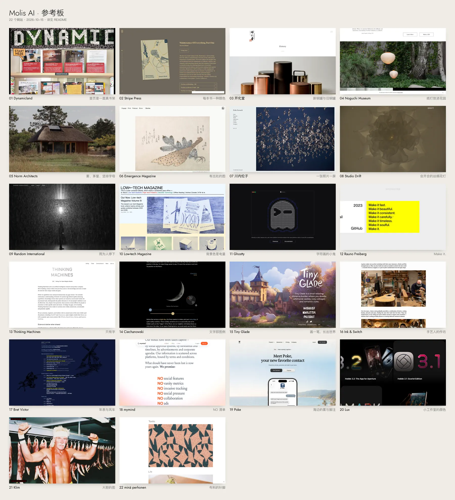

## 一览

| #   | 网站                    | 一句话：可以借什么                                                     |
| --- | ----------------------- | ---------------------------------------------------------------------- |
| 1   | Dynamicland             | 整个首页是一张书架的实拍照片，点书架上的东西进入内页                   |
| 2   | Stripe Press            | 书是可以转动的实物；每本书的页面换成这本书封面的颜色，版式不变         |
| 3   | 开化堂 Kaikado          | 两只茶筒就是「日本語 / English」两个按钮；新铜罐和用了几十年的罐子并排 |
| 4   | Noguchi Museum          | 纸灯放在真实的花园里，技术像器物一样放进自然                           |
| 5   | Norm Architects         | 竖排的字母、低饱和的自然摄影、像书一样的小号大写衬线                   |
| 6   | Emergence Magazine      | 自然题材的杂志，把一篇文章做成一件作品，用的是木版画和长文             |
| 7   | 川内伦子 Rinko Kawauchi | 一张照片占满一屏，导航细到几乎看不见；温度全在光里                     |
| 8   | Studio Drift            | 机械驱动的丝绸花灯在老房子里开合，技术和自然被做成同一件东西           |
| 9   | Random International    | 「雨屋」：人走到哪里，雨就停在哪里                                     |
| 10  | Low-tech Magazine       | 背景色就是太阳能电池的电量计，网站会因为阴天而下线                     |
| 11  | Ghostty                 | 首屏是一只用字符拼成、会动的小鬼                                       |
| 12  | Rauno Freiberg          | 纵向滚动推着一卷横向的卡片走，顶上一把刻度尺，结尾「Make it.」         |
| 13  | Thinking Machines       | 一家 AI 公司的首页只有字，像一篇论文                                   |
| 14  | Bartosz Ciechanowski    | 文章里的每个概念都能亲手拖一下；正文里的词和控件同色                   |
| 15  | Tiny Glade              | 画一条线，城墙和小路就自己长出来                                       |
| 16  | Ink & Switch            | 用手艺人作坊的照片，讲「软件应该能被使用者改造」                       |
| 17  | Bret Victor             | 一页年表列完一生的作品，旁边是堂吉诃德冲向风车                         |
| 18  | mymind                  | 用「NO」列出不做的事：不做社交、不做虚荣指标、不追踪                   |
| 19  | Poke                    | AI 产品放在海边的雾里；标题后面挂一个脚注编号                          |
| 20  | Lux                     | 三四个人的工作室，每个 App 的页面有自己的颜色，同时写深度长文          |
| 21  | Klim Type Foundry       | 卖字体的网站，用最不像字体广告的照片展示字体                           |
| 22  | minä perhonen           | 极安静的日式网站：左边一列竖着的小字导航，右边一块布料                 |

---

## 一、网站本身是一个真实的地方或物件

前几轮的网站都是「白纸上放东西」。下面四个，网站本身就是一个东西。

### 1. Dynamicland　<https://dynamicland.org>

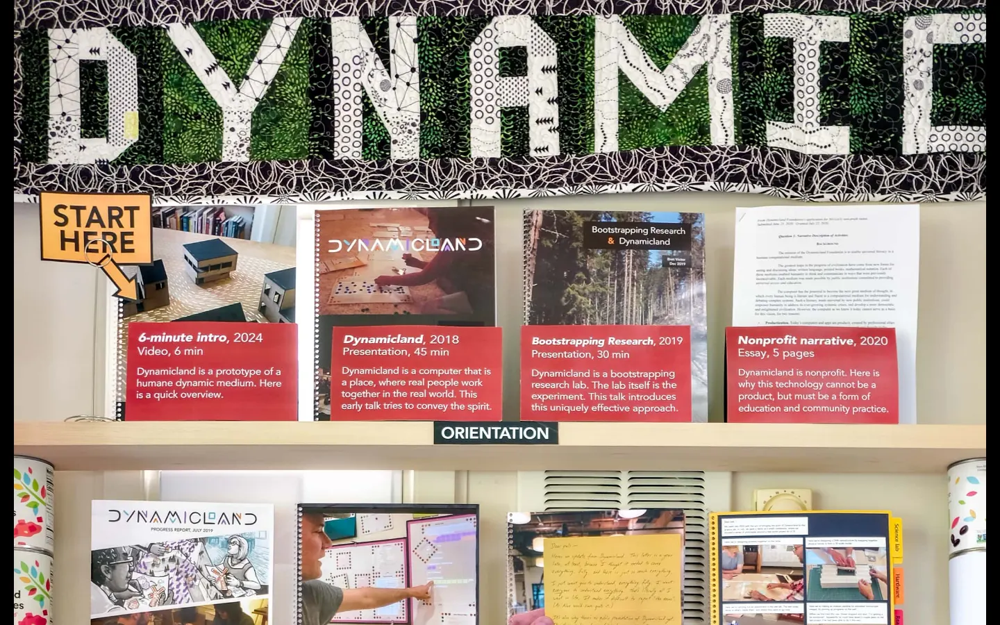
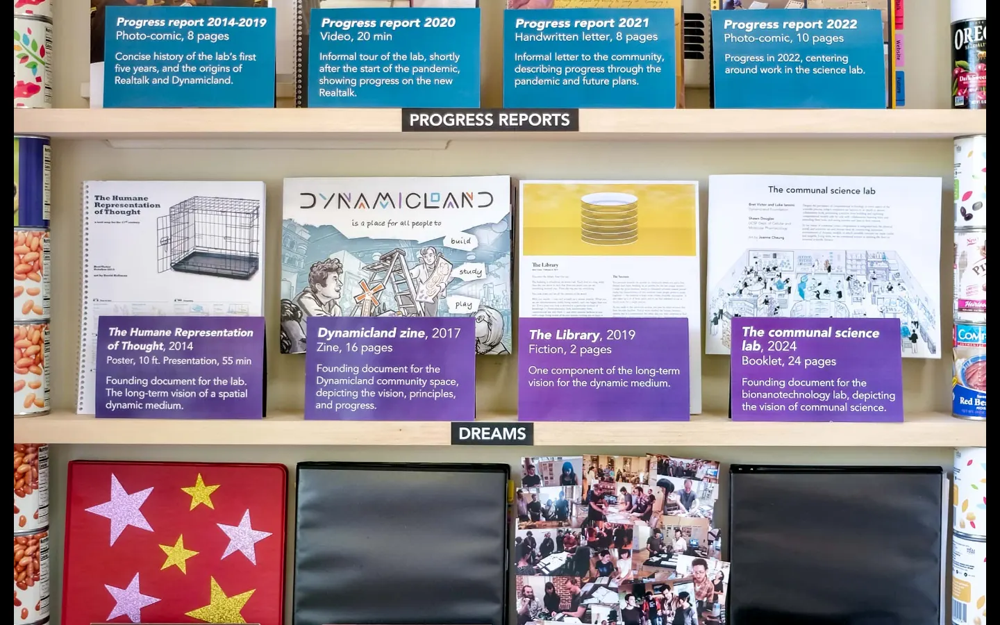

- **版式**：整个首页只有一张 2200×4002 的实拍照片：实验室里一面真实的书架。
  - 书架上摆着真实印出来的东西：小册子、海报、手写信、照片漫画。
  - 书架的每一层贴着手写的标签：ORIENTATION、PROGRESS REPORTS、DREAMS、EVERYTHING。
  - 网站的「导航」就是照片上的 17 块可点区域。没有顶栏，没有按钮。
- **交互的那一下**：鼠标停在一本小册子上，只有那一块微微压暗、带一点阴影，就像有人伸手去拿它。没有任何动画。
- **质感从哪来**：每一件都是真的印刷品，有折痕、有手写、有贴纸。网站的内容真的被做成了物件，再拍下来。
- **和 Molis 相通**：
  - Dynamicland 说自己是「一台本身就是一个地方的计算机」，人们在真实的世界里一起工作。它追的正是「技术，回到人的尺度」。
  - Molis 的五件产品、附录 A 的沿途、文章、Skill，都可以真的打印成小册子、卡片、海报，摆在工作室的桌上或架上拍下来，首页就是这张照片。
  - 同时做到三件事：人的尺度、质感，和「把做法随作品一起分享」。

### 2. Stripe Press　<https://press.stripe.com>

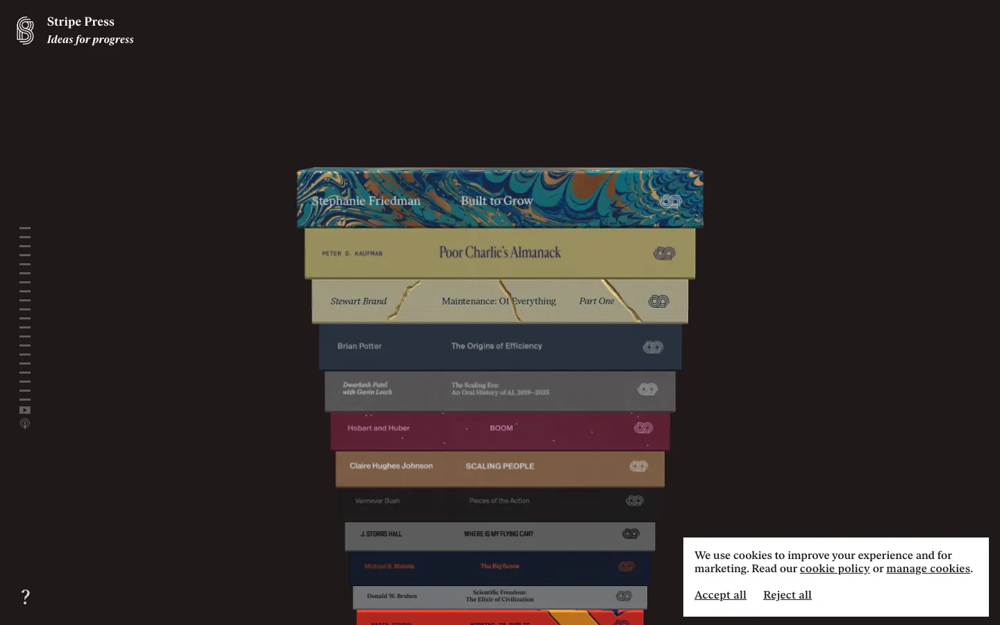
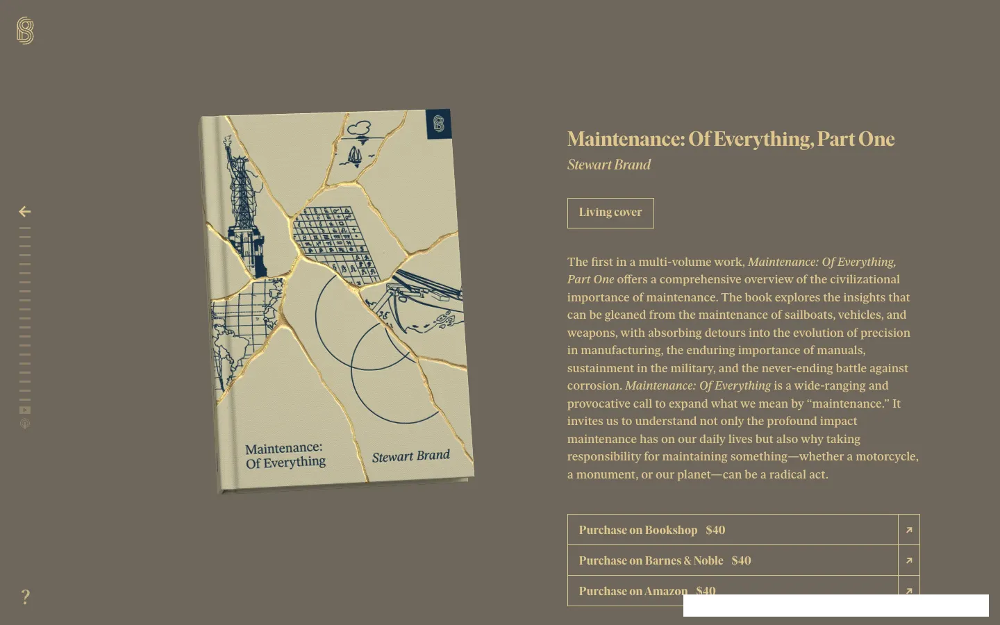

- **版式**：
  - 首页是一摞立体的书，书脊朝外，大理石纹、烫金、裂纹都是真实书的材质。
  - 左边一列短横线代表每一本书，是一把很细的「书脊索引」。
  - 点进一本书，左边是书，右边是书名、作者、简介和三个购买链接。
- **字**：经典衬线的书名，斜体的作者名，正文像书里的版权页一样小而密。
- **颜色**：每本书的页面整页换成这本书封面的颜色。《Maintenance》是橄榄灰配金线，别的书各是自己的颜色；版式完全不变。
- **交互的那一下**：书可以拖着转，从书脊转到封面。书页上有一个「Living cover」按钮，点开后封面上的金色裂纹会慢慢动起来。
- **和 Molis 相通**：负责人要「产品页按产品特性有个性，但整体不能突兀」，Stripe Press 是我见过的最好答案。
  - 所有书页的骨架一模一样，个性只放在两处：封面（物件）和整页的颜色。
  - Molis 的五件产品可以各是一本书或一件物件，进入产品页时，整页换成它的颜色。

### 3. 开化堂 Kaikado　<https://www.kaikado.jp>

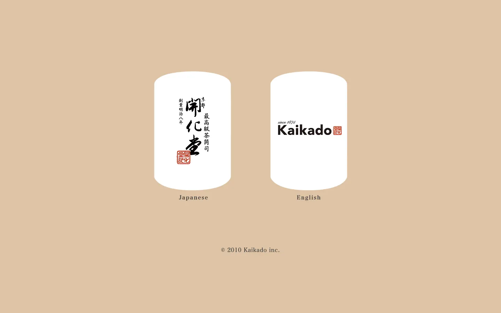
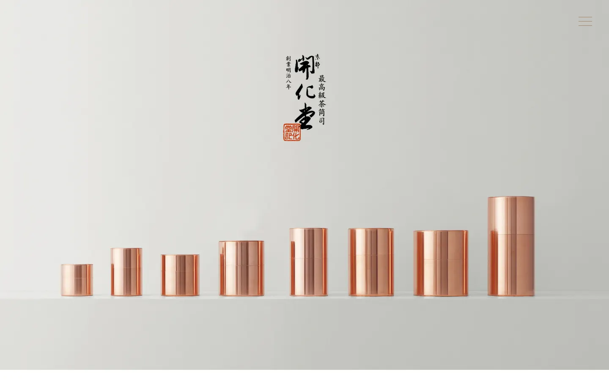
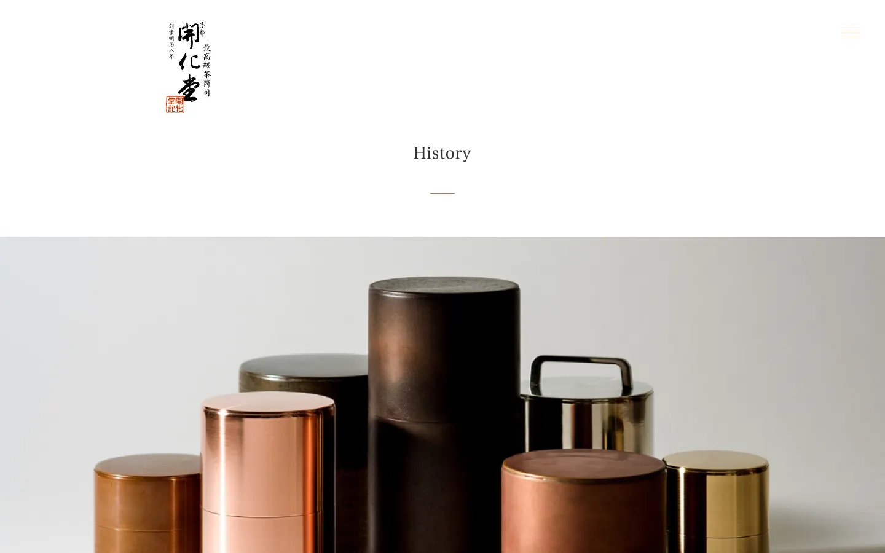

- **版式**：
  - 首页只有两只茶筒，一只印着毛笔写的「開化堂」，一只印着 Kaikado。它们就是「日本語 / English」两个入口。
  - 英文首页是一排铜罐，从小到大一字排开，四周大片留白。
- **图**：历史页把一只新做的、粉亮的铜罐，和几只用了几十年、变成深褐色的罐子放在一起。不写一个字，就说清了「东西会跟着使用它的人一起变老、变好看」。
- **字**：竖排的毛笔字号招牌配红色印章，其余几乎只有极细的西文。
- **和 Molis 相通**：
  - 开化堂明治八年（1875）创业，一直在做同一件东西，并且把它做得更好。这就是 1.6 里的「把品味落实到细节」。
  - 「东西会因为你的使用而变成你的」，正是 Life、Story、World 想要的感觉：留下进展，慢慢长大。
  - 首页让两件实物当按钮，也和 Dynamicland 是同一种思路。

### 4. Noguchi Museum　<https://www.noguchi.org>

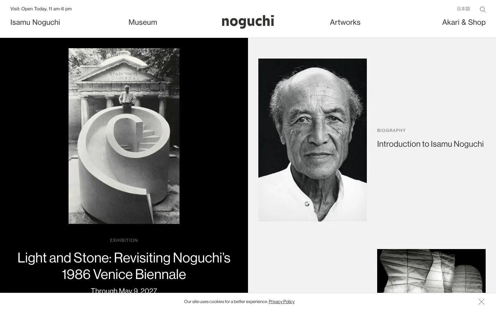
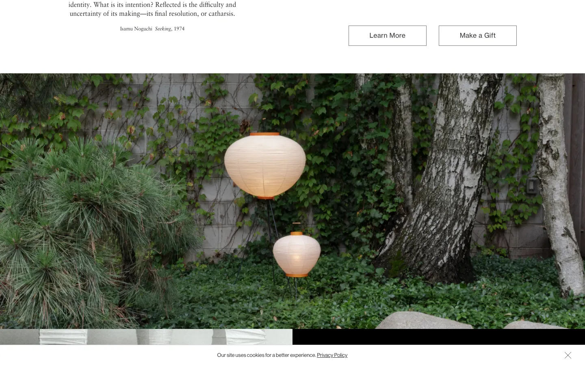

- **版式**：
  - 左右分栏：左边是黑底上的黑白展览大图（螺旋的石雕），右边是野口勇的肖像。
  - 往下是一段野口勇自己的话，署名「Isamu Noguchi, Seibu, 1974」，像展签。
- **图**：页尾整幅是花园里亮着的 Akari 纸灯。纸、竹、灯泡，放在常春藤、松树和白桦之间。
- **质感从哪来**：纸灯是技术（电灯），但被做成手工纸的器物，再放回自然里拍。光是真的光。
- **和 Molis 相通**：
  - 野口勇一生在做雕塑、家具、灯、花园和儿童游乐场，就是「写代码、做设计、讲故事，都可以是在创造」的另一个版本。
  - 「把技术做成器物，放回自然」这一张图，比我们任何一张白展厅都更接近「技术，回到人的尺度」。

---

## 二、自然不当背景，当主角

前几轮的自然只是窗外的风景。下面五个，自然本身就是内容。

### 5. Norm Architects　<https://normcph.com>

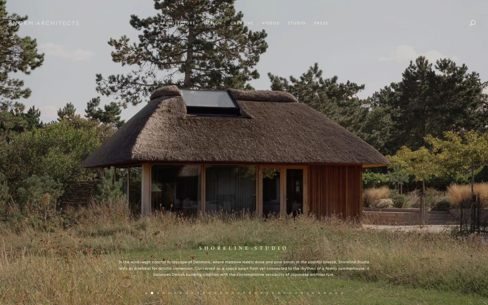
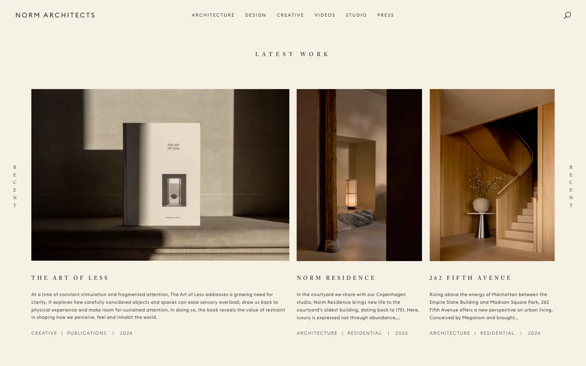
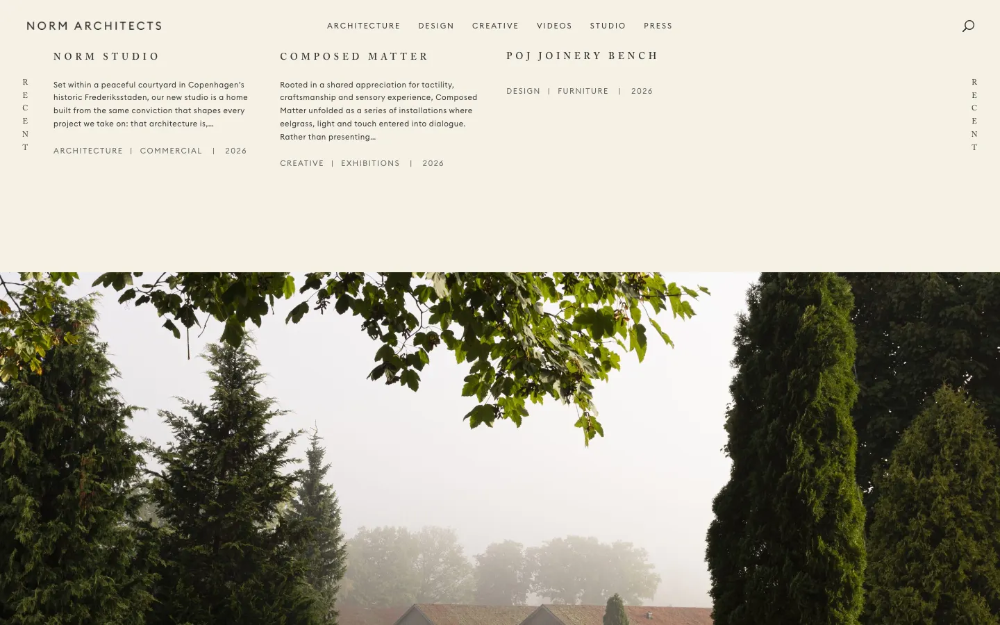

- **版式**：
  - 首屏一整张低饱和的照片：一座茅草屋顶的小屋，在荒草和松林里。
  - 往下是奶油色的纸底，三列作品；每件下面是小号大写衬线标题，加「ARCHITECTURE | RESIDENTIAL | 2026」这样的分类行。
  - 页面左右两侧的页边上，竖排着单个字母「R E C E N T」，像书的书口。
- **字**：全站只有一种小号、大字距的衬线大写。没有大标题，靠字距和留白显得贵。
- **图**：自然摄影统一偏暗、偏灰、偏雾。一张雾里的松林可以直接整幅放，不配一个字。
- **节奏**：一屏照片、一屏文字，交替出现；文字屏非常空。
- **和 Molis 相通**：
  - 这是「干净、极简、高级、有质感」最直接的样子。
  - 可以借给 Molis 的有三样：页边的竖排小字、雾一样的照片调色，以及「照片屏和文字屏完全分开」的节奏。
  - Jost 小号大写加大字距，可以达到同样的效果。

### 6. Emergence Magazine　<https://emergencemagazine.org>

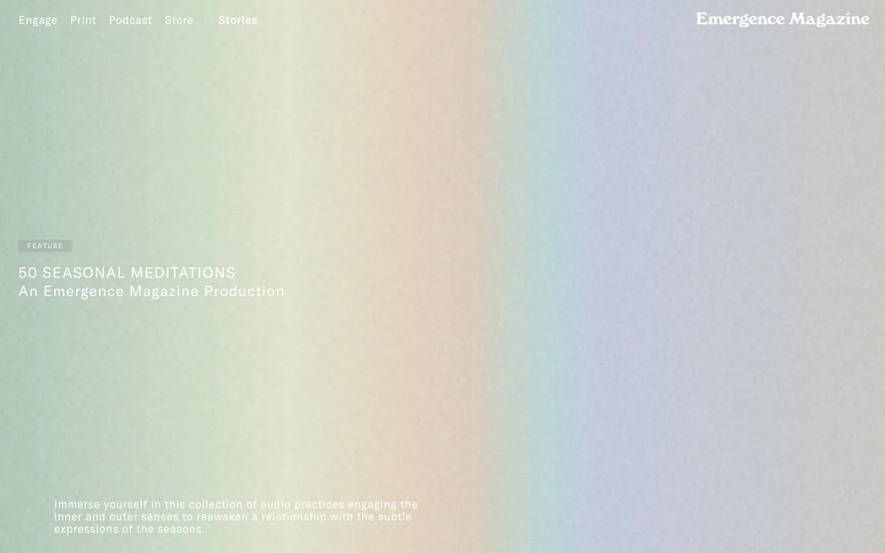
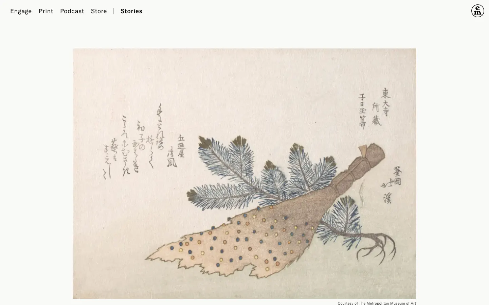
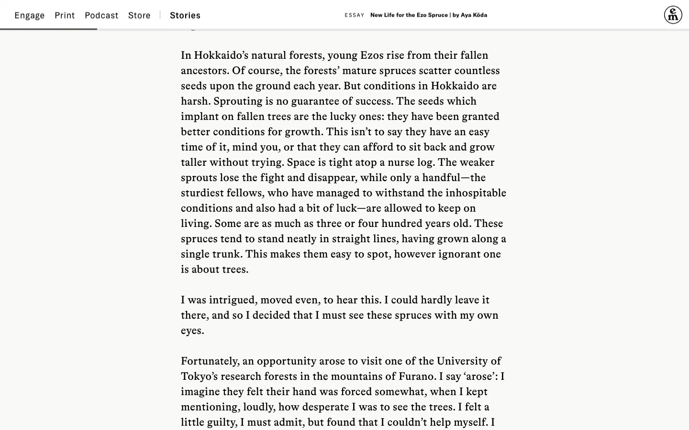

- **版式**：
  - 首屏是一片像光透过胶片一样的彩虹色渐变，只有一行很小的大写字：「50 SEASONAL MEDITATIONS」。
  - 文章页的头图是一幅带题字的日本木版画（松枝），图注写明来自大都会博物馆。
  - 正文是一栏衬线长文，行距很宽，像一本书。
- **质感从哪来**：配图都是有出处的东西：馆藏的木版画、手绘、纪录片，看不到素材图。他们也出版纸本年刊。
- **和 Molis 相通**：
  - 题材就是「自然与人」：生态、文化、灵性。
  - 「季节冥想」这种按时令推出的内容，和 Life、Story 的节奏感相通。
  - 文章页（《人的尺度》《落地主义》）可以学它的配图选择：用有出处的老图、手稿和实拍，不用 AI 生成的空房间。

### 7. 川内伦子 Rinko Kawauchi　<https://rinkokawauchi.com>

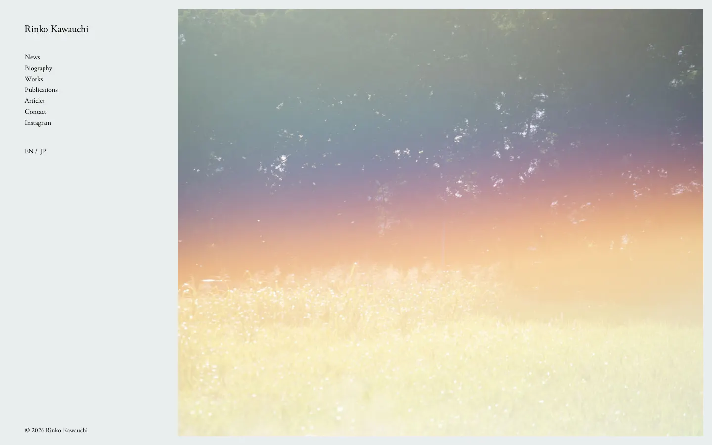
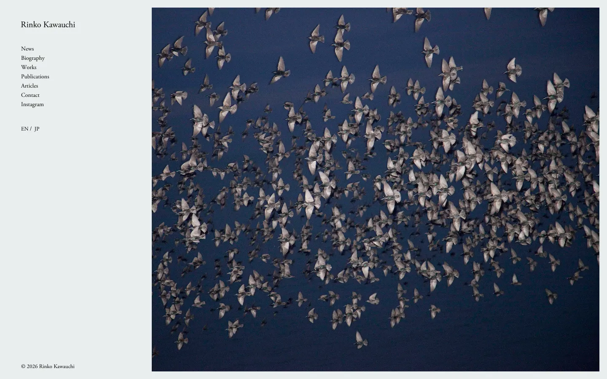

- **版式**：左边一条很窄的浅灰栏，放名字和七八个小字链接；右边一张照片几乎占满屏幕。往下滚，照片一张换一张。
- **图**：一张是光晕里的草地，彩虹色的漏光；一张是深蓝天上成千只鸟。她的作品全是日常里的光，温度都在照片本身。
- **和 Molis 相通**：
  - 「温度只来自照片里真实的光」，这句话写在上一版规格里，她的网站是标准答案。
  - Molis 的首页前两屏已经是这种照片。之后的部分可以学她的克制：照片要真的好，然后什么都不加。

### 8. Studio Drift　<https://studiodrift.com>

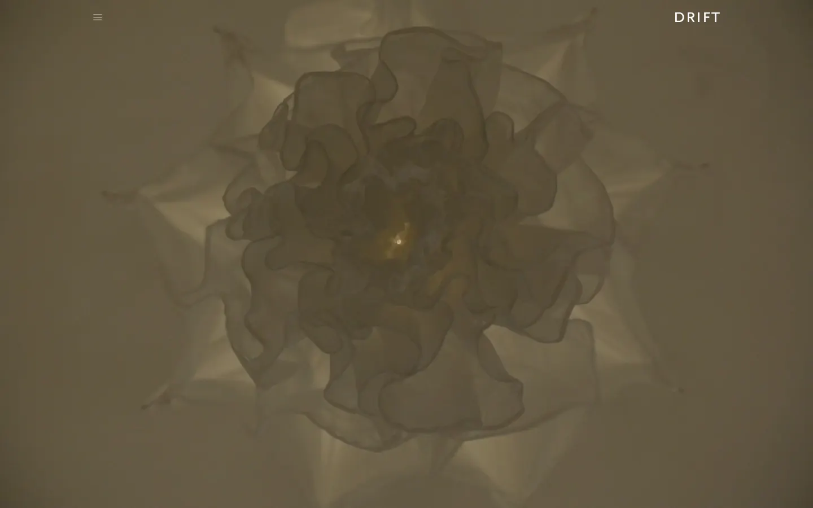
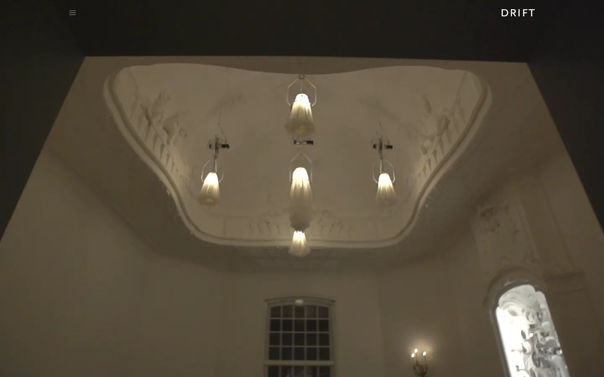

- **版式**：整页是一段全屏视频，只有右上角一个小小的「DRIFT」。
  - 视频里是他们的作品 Shylight：丝绸做的花形吊灯，在一座老建筑的大厅里慢慢降下、开放、再收起。
- **交互的那一下**：什么都不用做，看着灯像花一样开合，就是这个网站。
- **质感从哪来**：作品是真实的机械和丝绸，在真实的空间里拍。技术完全藏起来，只剩下像自然一样的动作。
- **和 Molis 相通**：
  - Studio Drift 一直在做「用技术模仿自然的动作」：花开、鸟群、风。
  - 上一版规格里写过「动效像物体落定」「好设计像自然」，它是这句话的极致版本。
  - Molis 可以给每件产品拍一段这样的「慢视频」，作为产品页的窗。

### 9. Random International　<https://www.random-international.com>

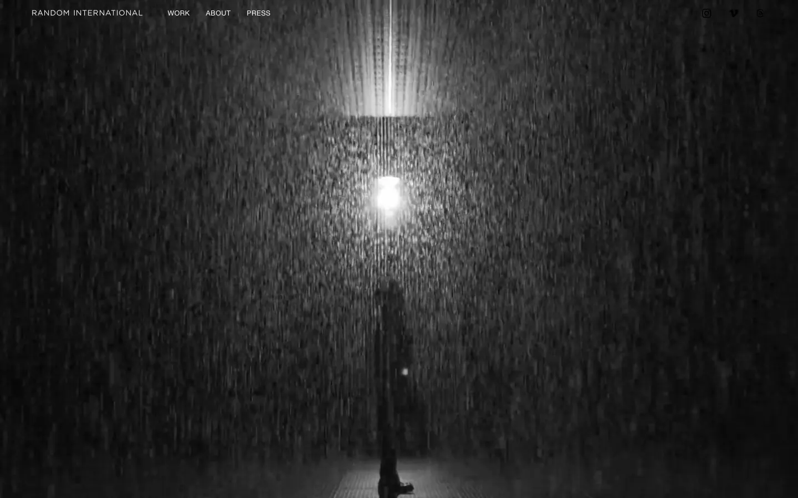

- **版式**：全屏一张《雨屋》的照片：黑暗里一束顶光，大雨落下，一个人站在中间，身边是干的。只有一行极小的顶栏。
- **和 Molis 相通**：
  - 《雨屋》讲的是：人走到哪里，雨就为人停在哪里，也就是技术围着人转。
  - 这句话放在 Molis 身上，就是「判断归人」「为人的习惯、感受和改变留下余地」。
  - 一张图讲完一个理念，可以借来当「我们相信」或关于页的那一幅。

---

## 三、理念写成规则，落在细节里

负责人说过「理念要体现在设计细节里，而不是口号」。下面四个网站，理念就是网站的运行规则。

### 10. Low-tech Magazine（太阳能版）　<https://solar.lowtechmagazine.com>

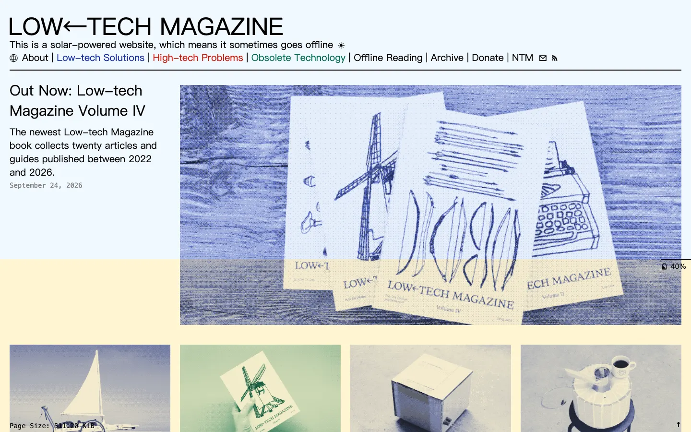
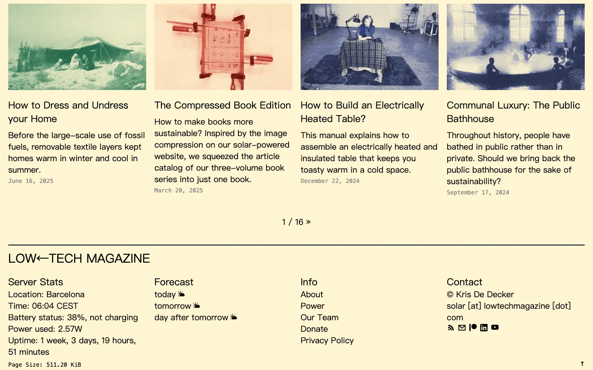

- **规则**：网站跑在巴塞罗那一台只靠一块太阳能板供电的小服务器上。
  - 页面顶部的背景色就是电池电量计：晴天电压高，整页变黄；阴天电量下降，露出蓝色。
  - 电压低于 12 伏时，系统关机，网站下线。
- **细节**：
  - 页尾写着服务器的实时状态：所在地、当地时间、电量「38%，未充电」、功耗 2.57W、已连续在线多久、明后天的天气预报。
  - 每一页底部写着这一页的大小，比如「Page Size: 511.20 KiB」。
  - 图片都做成了单色网点（抖动处理），为的是让页面更小、更省电，结果反而成了它的风格。
- **和 Molis 相通**：
  - 这是「理念在细节里」最好的例子：省电不是一句标语，而是背景色、图片的网点和页尾的数字。
  - Molis 可以找到自己的那条规则。比如「愿景是假说」「诚实说明做到了哪里」，可以变成真实、实时的状态：Work 仓库这周的提交、最近一次构建。

### 11. Ghostty　<https://ghostty.org>

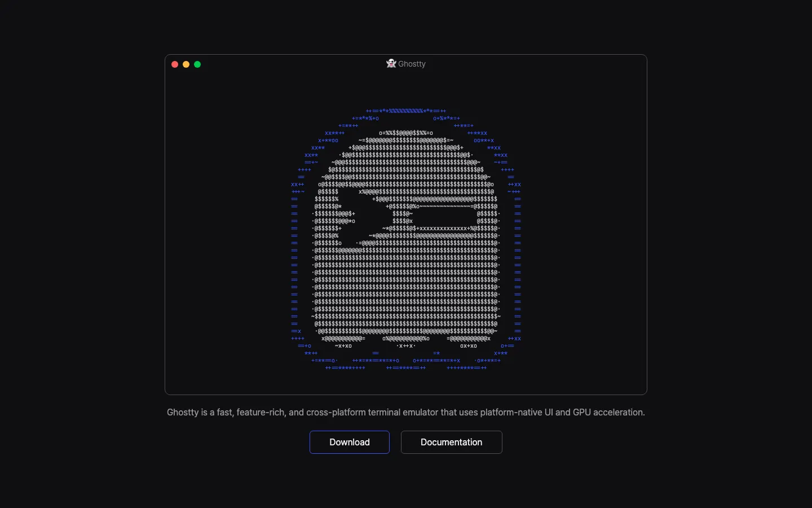

- **版式**：首屏是一扇终端窗口，里面是一只用 ASCII 字符拼成的小鬼，在一帧一帧地动。下面一句话和两个按钮。
- **质感从哪来**：动画完全是字符做的，符合产品本身（一个终端）。作者是独立开发者，这是一个「把想法亲手做出来」的人才会做的首屏。
- **和 Molis 相通**：
  - 这是「黑客与画家」：程序员用他的媒介画了一幅画。
  - Molis 的首页不需要字符画，但可以学这个思路：每件产品的首屏画面，用这件产品自己的材料做出来。Tool 用选区和光标，Work 用一页文档的修改痕迹，World 用一块块可以摆放的地块。

### 12. Rauno Freiberg　<https://rauno.me>

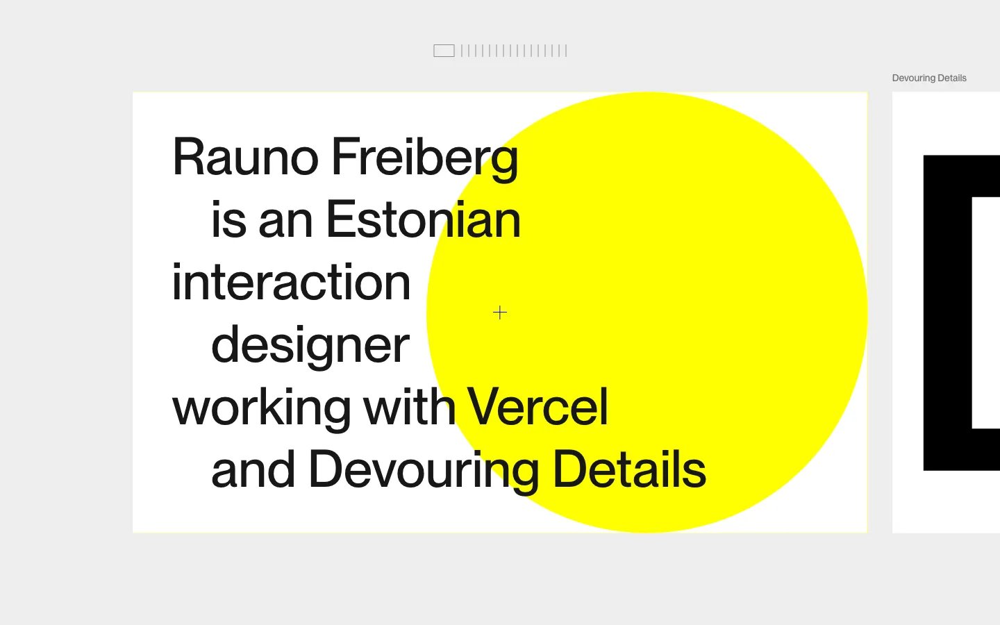
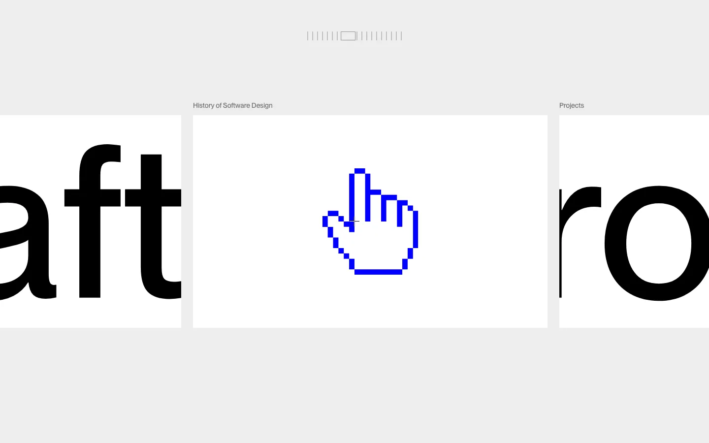
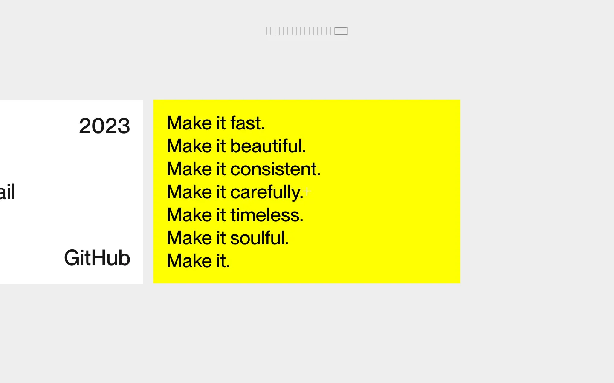

- **版式**：纵向滚动推着一整卷横向的白卡片往左走。
  - 每张卡片是一块内容：Devouring Details、Craft、History of Software Design、Projects、Field Notes。
  - 卡片里的字大到被卡片边缘裁掉，比如只看得见「aft」「ro」。
- **细节**：
  - 页面顶上有一把细细的刻度尺，中间一个小方框，表示你走到了哪里。
  - 有一张卡片上只有一只像素画的蓝色小手。
  - 第一张卡片上压着一个大大的黄色圆；最后一张是黄色卡片，写着：「Make it fast. Make it beautiful. Make it consistent. Make it carefully. Make it timeless. Make it soulful. Make it.」
- **和 Molis 相通**：
  - 他的网站就是一份「把品味落实到细节」的作品集。
  - 结尾那七个「Make it」，和 1.6「我们怎样要求自己」几乎是同一段话，而他用的是一张卡片、一种颜色、一行一句。
  - 「我们相信」可以学这种干脆，不必做成六块大版面。

### 13. Thinking Machines　<https://thinkingmachines.ai>

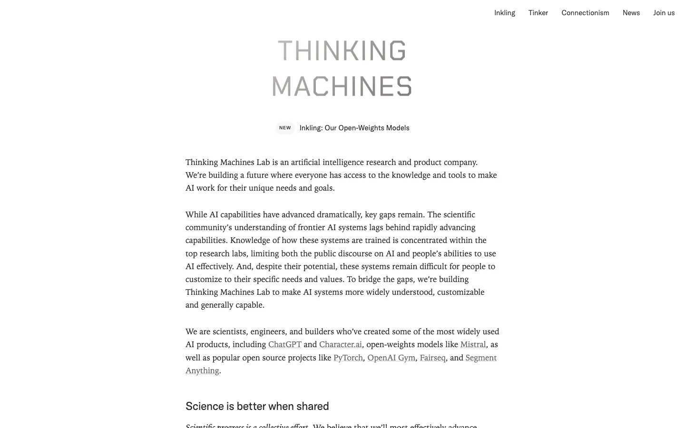

- **版式**：一家顶级 AI 公司的首页：一个灰色、大字距的等宽感字标，下面一栏衬线正文，像一篇论文的引言。没有图，没有动效，没有产品截图。
- **和 Molis 相通**：它说明了「高级」可以只靠字：一栏好排的正文，加上对内容的自信。它也是一个反面提醒——这样做要有足够好的文字，而且很容易被读成「白纸黑字」，Molis 只适合在关于页和文章页借用。

---

## 四、让人亲手试一下

Molis 的信念里有一句「把想法做成可以试的东西」。下面四个网站，让读者亲手做。

### 14. Bartosz Ciechanowski　<https://ciechanow.ski>

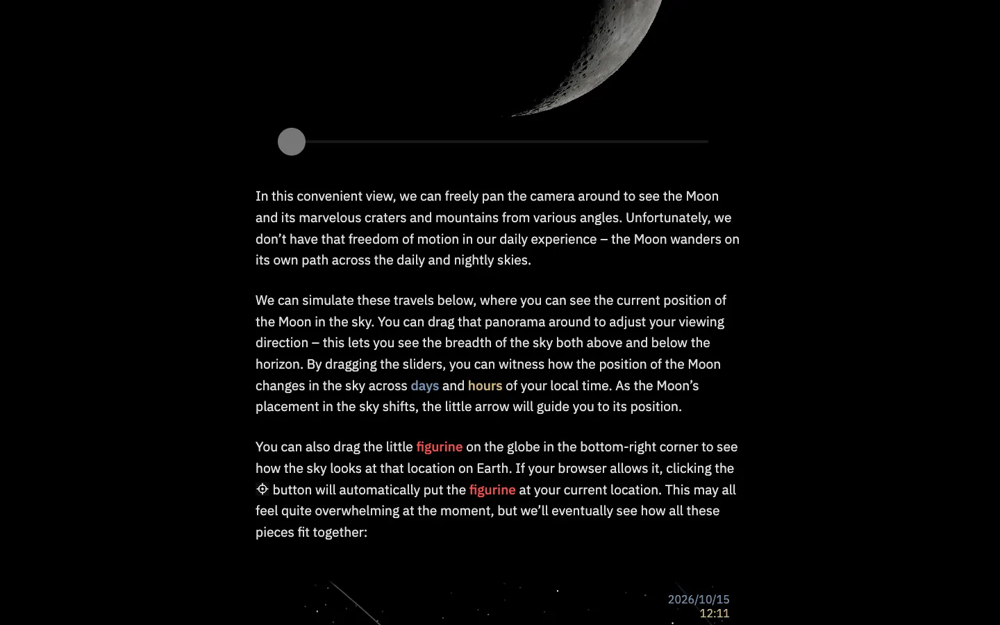
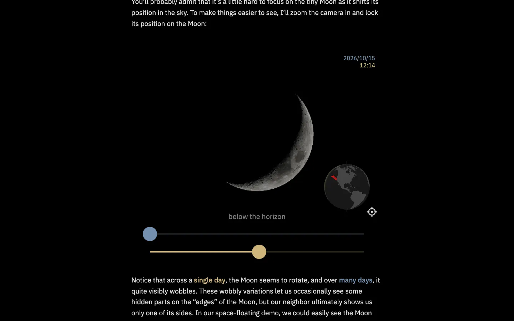

- **版式**：一篇讲月亮的长文。文字之间夹着一个个可以拖动的 3D 小模型：转动月亮、拖动「日」和「时」两根滑杆、把地球上的小人拖到另一个城市，看天上的月亮怎么变。
- **细节**：正文里的「days」「hours」「figurine」分别染成蓝、黄、红，正好是下面控件的颜色。文字本身就是控件的图例。
- **质感从哪来**：每个模型都是作者亲手写的，没有一个是装饰。读者「看懂」靠的是自己拖一下。
- **和 Molis 相通**：
  - 产品页的「标志性交互」，比如 Life 拨动「这周空出多少时间」、Tool 选中任意一句话，可以做成这种样子：嵌在文字里，文字里的关键词和控件同色。
  - 这比「演示动画」更诚实：示意就是示意，但真的能动。

### 15. Tiny Glade　<https://tinyglade.com>

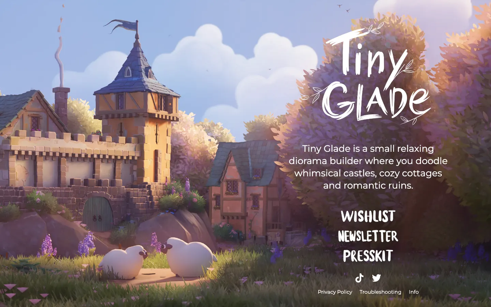

- **版式**：首屏一整幅像水彩又像模型的小世界：城堡、小屋、羊、晚霞。右边一句话：「一个小小的、放松的模型搭建游戏，随手画出城堡、小屋和浪漫的废墟。」
- **交互的那一下**（游戏本身）：你只要画一条线，城墙、石阶、小路、常春藤就自己长出来，而且长得很好看。没有任务，没有失败。
- **和 Molis 相通**：
  - 这几乎就是 Molis World 想要的感觉：「从一个在意的地方开始」「慢慢长大」「亲手搭建本身就值得停留」。
  - World 的概念页可以学它：只有一个小世界和一句话；访客画一笔，世界长出一点。

### 16. Ink & Switch　<https://www.inkandswitch.com>

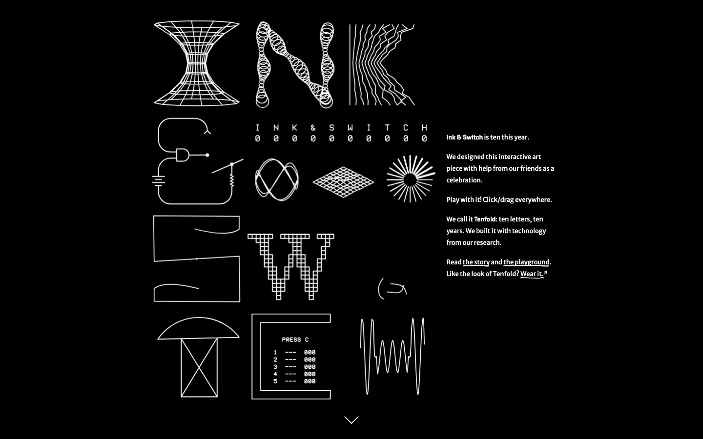
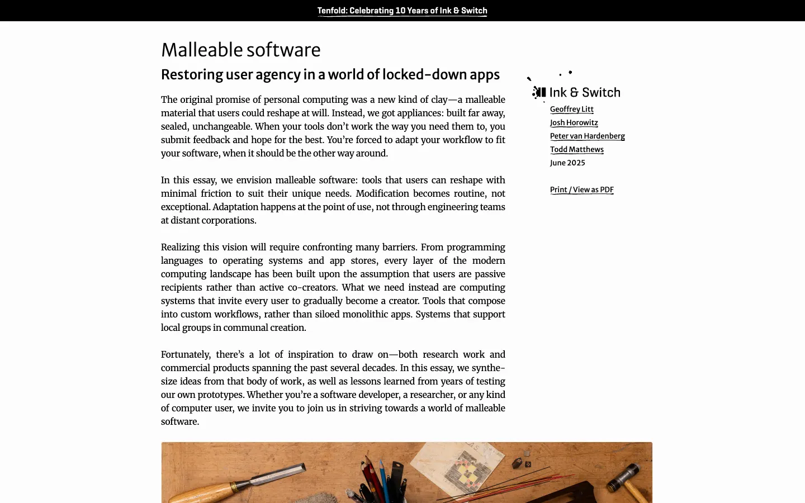
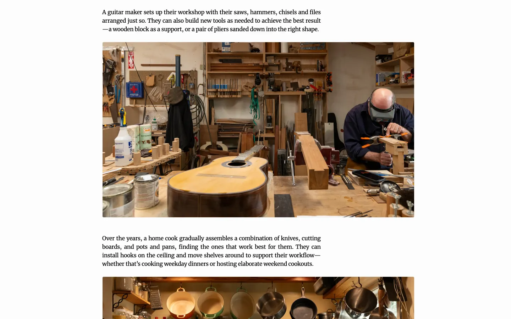

- **版式**：
  - 首页是黑底白线的图标阵，像一张科学仪器的图谱。
  - 文章页像论文：正文一栏，作者名和日期列在右侧页边，可以下载 PDF。
- **图**：《Malleable software（可塑的软件）》一文，用的不是软件截图，而是一位吉他匠人和一位厨师的工作间：墙上挂满他们自己做或改过的工具。一张照片说清了「工具应该能被使用它的人改造」。
- **和 Molis 相通**：
  - Work 的「工作台也可以长出你自己的工具」，和这篇文章是同一个想法。
  - Work 产品页讲插件创作台时，可以借它的配图思路：拍真实的工作台、工作间，别画一个「插件市场」界面。
  - 他们也做本地优先软件（local-first），和 Work「工作数据保存在本机」相通。

### 17. Bret Victor　<https://worrydream.com>

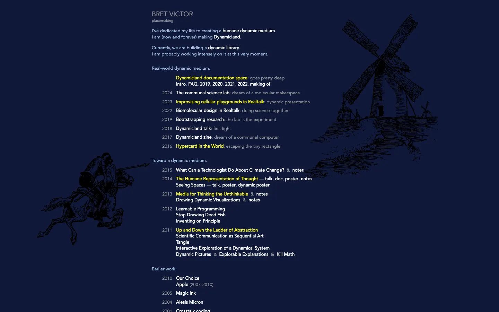

- **版式**：深蓝底上一页长长的年表，从 2024 往回排到 2001，每一年一两行作品名；重要的几件标成黄色。右边和左下是一幅铜版画：堂吉诃德骑马冲向风车。
- **和 Molis 相通**：
  - 「沿途」页（附录 A）可以直接学它：一页年表，把做过的尝试按问题和年份列出来，重要的点亮。
  - 那幅冲向风车的骑士，就是「一点不驯」：不用写这个词，放一幅画就够了。

---

## 五、有性格的产品与工作室

### 18. mymind　<https://mymind.com>

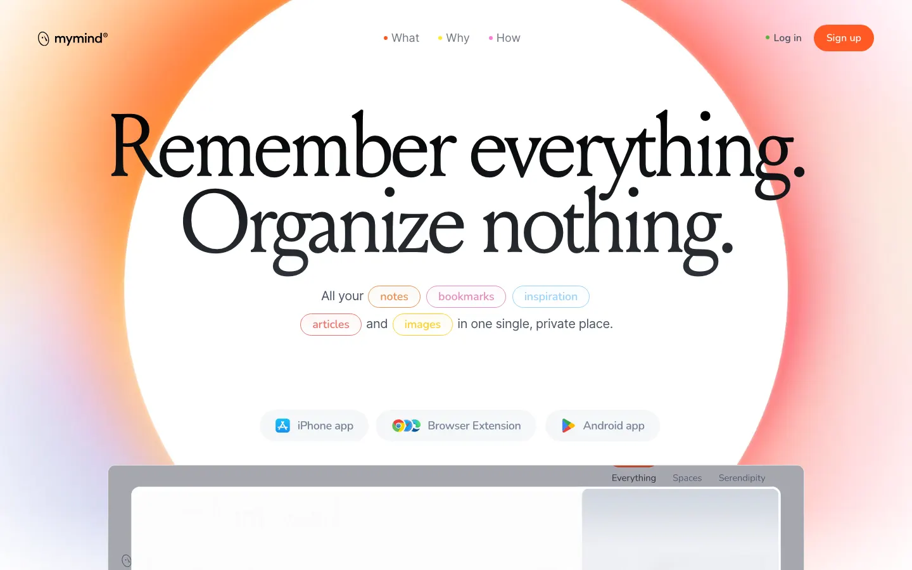
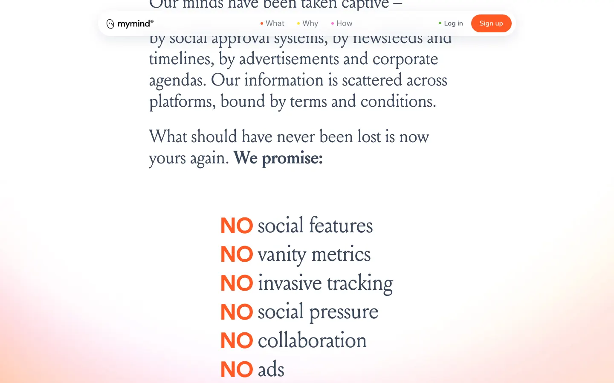
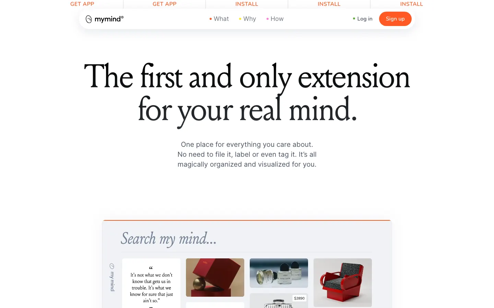

- **字**：
  - 一款 AI 收藏工具，标题用很文气的衬线：「Remember everything. Organize nothing.」
  - 搜索框里的提示语也是衬线斜体：「Search my mind…」
- **细节**：页面中段用大号衬线列出它不做的事，每一行用一个杏橙色的「NO」开头：不做社交功能、不做虚荣指标、不做侵入式追踪、不给社交压力、不做协作、不放广告。
- **颜色**：白底上几团很淡的杏色、粉色光晕。
- **和 Molis 相通**：
  - 「找同类，不抢货架」可以这样写成设计：大方地说「我们不做什么」。
  - mymind 的强调色是和 Molis Logo 很接近的杏橙，可以看看同一种颜色用得更大胆是什么样子。

### 19. Poke　<https://poke.com>

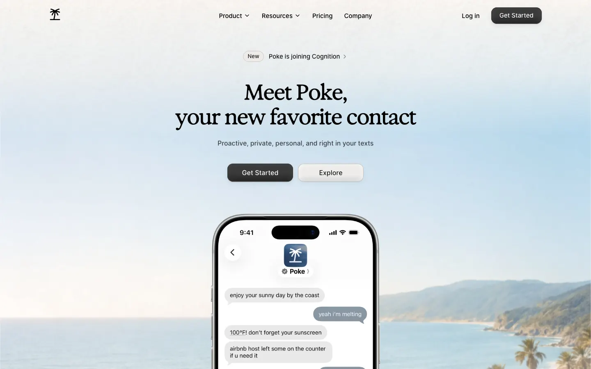
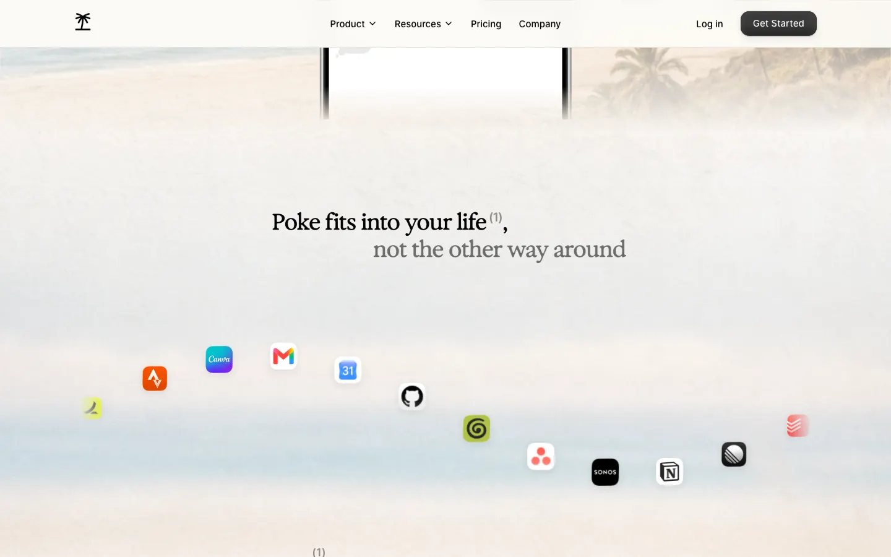

- **版式**：
  - 一款 AI 助理，首屏背景是一张雾蒙蒙、低饱和的海边照片，一部手机立在海前。
  - 往下，海和天变成一层带纸纹的米白，各种 App 的图标像漂浮物一样散落在雾里。
- **字**：衬线标题「Poke fits into your life, not the other way around」，在「life」后面挂着一个上标的「(1)」，像论文的脚注编号。
- **和 Molis 相通**：
  - 它和 Molis Life 的气质很近：海边、雾、AI 退到生活后面。
  - 正因为太近，要看清它：一张海边照片加衬线字，已经开始成为 AI 公司的新套路。
  - 值得借的是脚注这个形式：Molis 可以在一句宣传语后面挂一个小编号，在页底老实地写清它的限制。这就是「诚实说明已经做到的和仍在探索的」。

### 20. Lux（Halide、Kino 的作者）　<https://www.lux.camera>

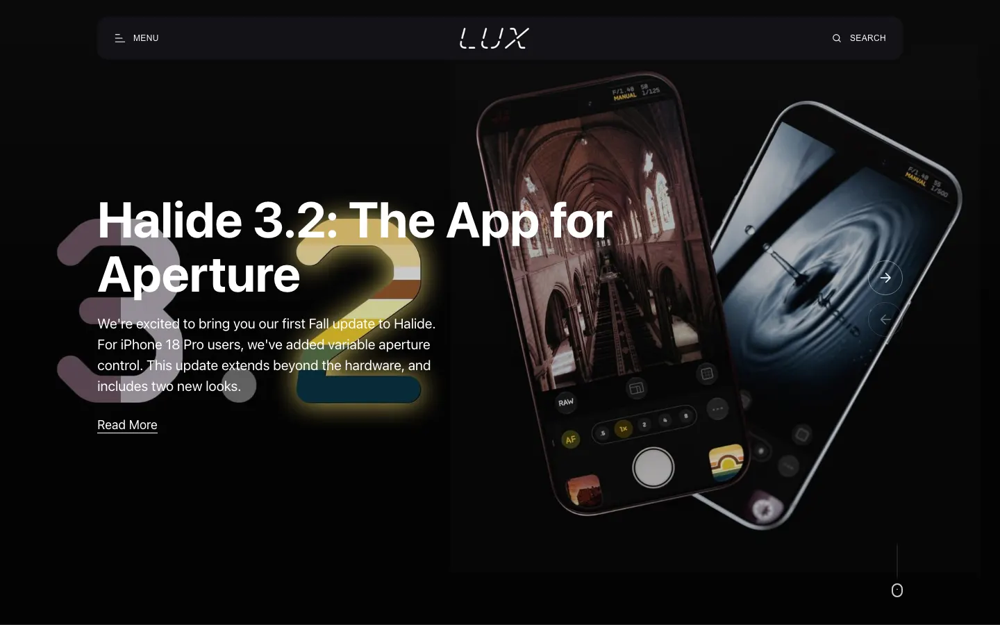
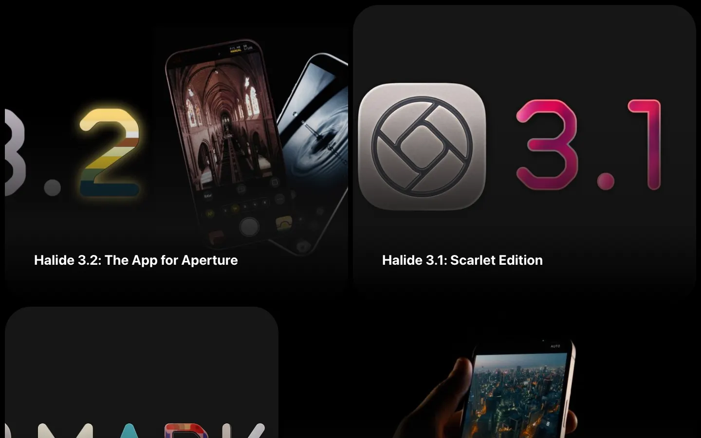

- **版式**：
  - 一家只有几个人的工作室，同时做几款相机 App。
  - 首页像一本杂志：每次更新是一张大卡片，版本号被做成发光的大数字（「3.2」「3.1」），每一张有自己的颜色。
  - 中间夹着他们写的深度长文，比如讲 Apple Log 的原理、评测新 iPhone 的相机。
- **和 Molis 相通**：
  - 这是「小而强的产品工作室」的样子：几件产品各有颜色，统一在一种黑底、一种字和一种卡片里。
  - 他们靠写专业长文来证明自己的品味，Molis 的「文章」和「社区方法」可以承担同样的角色。

### 21. Klim Type Foundry　<https://klim.co.nz>

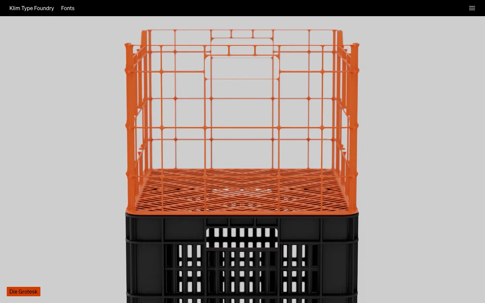
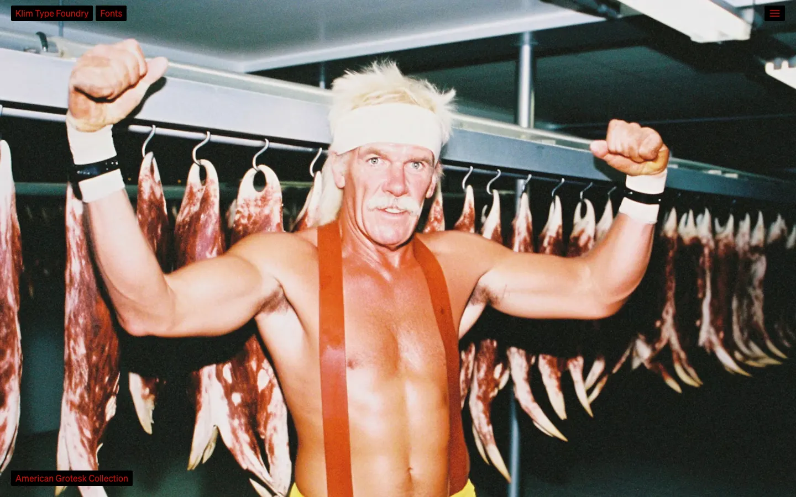
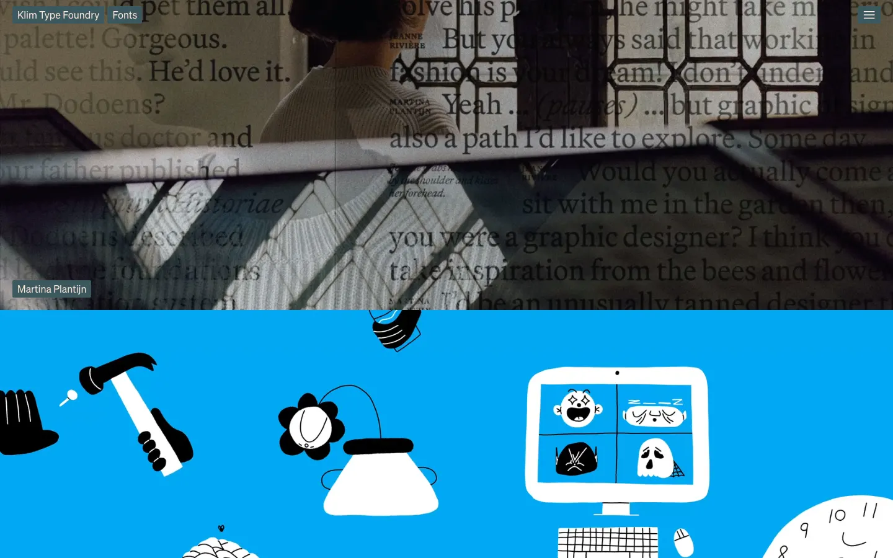

- **版式**：
  - 一家新西兰的字体铸造所。每套字体用一张完全出人意料的满幅照片介绍：一只橙色的塑料筐；一个戴头带的健美老人站在挂满肉的冷库里。
  - 字体名只是左下角一个黑色小标签，比如「American Grotesk Collection」。
  - 再往下，一大段字压在照片上，照片被字切开，接着是一整屏天蓝底、黑白线描的插画。
- **质感从哪来**：极度的自信。只要图选得准，不需要解释。
- **和 Molis 相通**：这是「有玩心和一点不驯」最成熟的样子。它也提醒我们：前几轮的图太「安全」了，全是同一种白房间。

### 22. minä perhonen　<https://www.mina-perhonen.jp>

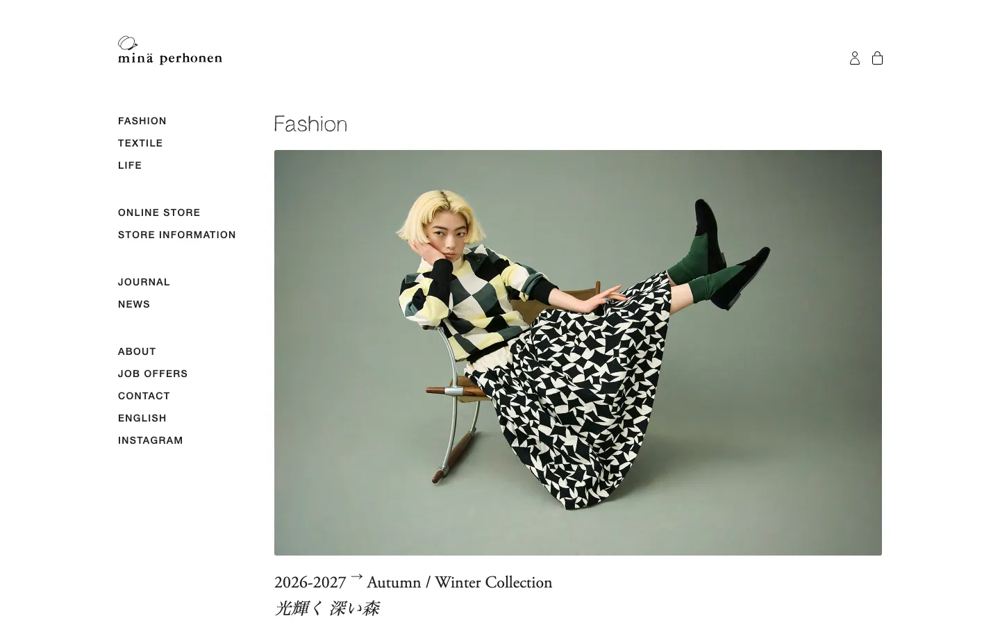
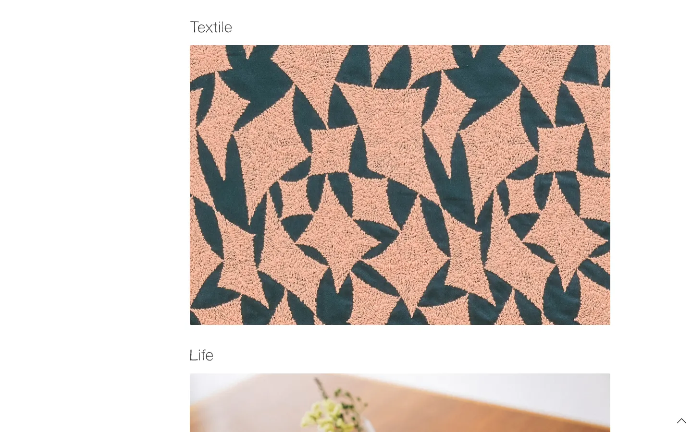

- **版式**：
  - 左边一列极小的大写字母导航，竖着排下来：FASHION、TEXTILE、LIFE、ONLINE STORE……
  - 右边一张照片，或者一大块布料的特写，标题只是一个灰色的小词「Textile」「Life」。
  - 日文说明用小号字，系列名中英文并排。
- **图**：布料特写拍到能看清每一针绣线，这就是质感本身。
- **和 Molis 相通**：
  - 这家品牌一直强调把东西做得能用很久，和开化堂同属一种精神。
  - 网站做法是中英日混排和极小导航的好范例：苹方小字加 Jost 小号大写，可以达到这种安静。

---

## 从这些参考里能长出的方向

这些只是种子，不是定稿。每个都尽量和上一版四个方向不同。

### 种子 A：工作室的桌面（实拍做导航）

- **来自**：Dynamicland、Stripe Press、开化堂、Noguchi。
- **核心想法**：把五件产品、文章、沿途、Skill 真的打印、做成实物，比如小册子、卡片、一本书、一个纸模型小岛，摆在工作室的一张木桌上，靠窗、真实的光，拍下来。首页前两屏之后，就是这张照片。
- **五件产品的实物**：
  - Work：一叠写满批注的报告
  - Tool：笔记本电脑旁一张小卡片
  - Life：一张海边明信片
  - Story：一本书
  - World：一个纸做的小岛
- **三处大概的样子**：
  - **首页产品区**：仍然是「左列表、右舞台」，但右边的舞台就是那张桌面照片。选中哪件，桌上哪件被轻轻拿起、压暗四周。
  - **产品页**：整页换成这件实物的颜色，学 Stripe Press。
  - **「我们相信」**：桌上六张手写卡片。
- **让人记住的那一下**：发现网站是一张真照片，而且照片里的东西真的存在。
- **风险**：要真拍、要做实物，前期功夫最多；拍不好就是一张普通的产品照。

### 种子 B：活着的状态（包浆与电量）

- **来自**：Low-tech Magazine、开化堂、川内伦子。
- **核心想法**：网站有一个真实、诚实、会变的状态，就像 Low-tech 的电量，或开化堂铜罐上的包浆。
- **可能的规则**：
  - Work 页的阶段圆点和底色，取自开源仓库这一周真实的提交与构建情况。「开发中」不再是一个标签，而是看得见的活动。
  - 首页的照片随访客所在地的真实时间，换成清晨、正午或傍晚拍的版本。
- **对应的信念**：「愿景是假说」「诚实说明做到了哪里」，变成了数据和颜色。
- **风险**：
  - 数据要真，不能装。
  - 没有提交的周，页面会显得「冷」。这本身也是诚实，但需要负责人接受。

### 种子 C：一卷手卷

- **来自**：Rauno 的横向卷轴、Ciechanowski，以及中国的手卷（像《千里江山图》那样从右往左展开的长卷）。
- **核心想法**：首页前两屏之后，页面变成一卷横向展开的长卷。往下滚，长卷向一侧展开。
  - 五件产品是长卷里的五段风景：工作的桌子、手边的一瞬、去海边的路、另一个世界、一座岛。
  - 顶上是 Rauno 那样的刻度尺；卷尾盖一方「始终好奇，持续创造」的印。
- **为什么适合**：这是最「中国」、也最出乎意料的一个；Story 的「走进去」和自然题材都很顺。
- **风险**：
  - 违反了上一版规格「原生滚动不劫持」，需要负责人决定。
  - 手机上要改成纵向展开。

### 种子 D：技术像一盏灯

- **来自**：Noguchi 的 Akari 纸灯、Studio Drift、雨屋、Norm Architects。
- **核心想法**：每件产品被做成一件发光的器物，放进真实的自然里拍：黄昏的海边、雾里的林子、窗台上。
  - 界面像光一样投在纸上，而不是悬浮在白底上。
  - 全站的主色从近白改成黄昏的灰蓝；唯一的暖色是灯光，也就是 Logo 的杏橙。
- **让人记住的那一下**：每件产品的产品页首屏是一段 Studio Drift 式的慢视频：一盏纸灯在风景里慢慢亮起来。
- **风险**：
  - 需要实拍或高质量的生成视频。
  - 和第九轮「光是主角」容易混。区别是：这里的光是真实拍到的器物，不是界面上画出来的光影。

### 种子 E：可以亲手玩的说明书

- **来自**：Ciechanowski、Tiny Glade、Bret Victor。
- **核心想法**：每一页都有一个可以亲手拨动的东西，而且是页面的主角，不是附加的小玩意。
  - 正文里的关键词和控件同色，文字就是图例。
  - World 页像 Tiny Glade：画一笔，长出一点。
  - 沿途页像 Bret Victor：一页可以筛选的年表。
- **风险**：工程量大；每个交互都要真的好玩，做得半吊子会比静态更差。

---

## 为什么前几轮显得平庸（看完这些参考后的判断）

1. **参考选窄了。** 前几轮的参考大多是产品官网，学到的就是官网的语法：大标题、小字、产品截图、按钮。这次的 22 个里，最打动人的是一面真书架、一摞书、两只茶筒、一盏纸灯、一个会因为阴天下线的网站。它们的质感来自真东西。
2. **配图太安全。** 前几轮全是同一种 AI 生成的白展厅，没有人，没有具体的物件，也没有出处。Klim、Emergence、开化堂说明：一张选得准、有来历的图，胜过一切版式。
3. **理念停在比喻上。** 「白盒子美术馆」「光是主角」「创作者的墙」都是给页面套一个比喻。Low-tech 和 Dynamicland 是让理念变成规则：网站真的靠太阳供电，首页真的是一面书架。
4. **个性只靠装饰。** Stripe Press 和 Lux 说明，产品之间的个性可以只放在两处：一件物件和一种颜色，骨架完全不动。前几轮是每个方向换一套装饰，所以每一版都像一个模板。

如果要我从这些种子里挑一个往下做：我会先试 **A（工作室的桌面）**，再加上 **B 的一条诚实状态**。前者解决「质感」和「人的尺度」，后者解决「理念落在细节里」。两者都需要的是真东西，不是更多的版式。
