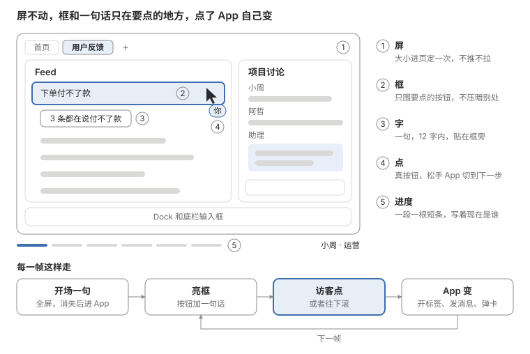

# Work 页第六轮：一个 case，一块屏，访客自己点

Nov 6, 2026 · @dili

**整个 App 钉在屏幕上不再缩放，访客点框住的按钮，App 真的切到下一步；全景和 case 合成一条，一家小公司的一天，从首页开始，把四件事串完。**

现在要你确认的是「核心功能」那一节的三档划分。确认后我再写 case 脚本，页面代码还没动。

第五轮诊断里「补三拍、合并到 14 拍、先修不动结构的」这些改法作废；按角色的诊断和产品需求继续有效。

## 和王一骏聊出了什么

结论是形式用 HTML 那种一扇窗放着不动，故事换成最简单的、一个公司一天里的事。

| 聊到的 | 原话 | 落到页面上 |
| --- | --- | --- |
| 不缩放 | 「真的不要缩放」 | 窗的大小进页定一次，之后只有窗里的东西变 |
| 全屏 | 「我觉得全屏展示重要」 | App 铺满视口，只留一指宽的边 |
| 不要左栏 | 「左边不用了」；你说「我得左右两边撇着看」 | HTML 左边的步骤列表不搬过来 |
| 开场一句 | 「开始一句话」「然后文字消失，出现全屏」 | 每段开头一句全屏的话，消失后进 App |
| 最简单的 case | 「拿最简单的case」 | 换掉划线卡片和模拟用户，用谁都懂的事 |
| 四件事串起来 | 「把这四个场景串起来」「一锅出」 | 用户反馈到修复、数据分析出报告、开会出活动方案、找素材写公众号，前一件的产出是后一件的材料 |
| 有个开始 | 「首页进入，开启一天工作，不然乱的」 | 第一帧是产品首页，某人开始了一天的工作，看到几条反馈 |
| 切换视角 | 「模拟一个运营的一天」「可以切换视角」 | 主角是运营；修复那段切到研发视角，运营变成旁观者 |
| 现场搓插件 | 「现在没有现成的插件，可以现场搓一个」 | 数据那段没有现成工具，当场做一个 |
| 跨插件 | 「这里好像都是只是在Goal里」「这里切换不明显」 | 每段至少换一个插件，标签切换做成画面里最明显的变化 |
| 资产流转 | 「展示资产的流转」 | 同一份东西一路带着走，标签条就是它走过的路 |
| IM 的作用 | 「要让人意识到」「是IM协作的」 | 每段的转折都发生在讨论里 |
| 人先说，助理总结 | 「最好是人和阿哲先对话」「然后助理总结出来」 | 讨论区先是人和人说，助理收尾 |
| UI | 「得抄」 | HTML 的 UI 细节搬进页面，同时记成产品输入 |
| Jev 的两种表现 | 「同一个文档内选不同的内容，推荐的不一样」「不同的插件内，不同的行为出来的东西也不一样」 | 同一篇稿子选两处，推荐不同；Feed 和稿子里各选一次，出来的东西不同 |
| 主动式要明显 | 「比如你干着干着」「助理出来给你个什么」 | 至少一帧：访客正写着，助理自己递上一样东西 |
| 新插件立刻能用 | 「就立刻能自动注册，被助理用」 | 搓好、接上的下一句，助理就在用 |

Jev 是判断服务，选区旁的推荐和判断规则都靠它。王一骏估上一版二屏讲到 70%，缺的是 Jev、Coding、Computer Use、Artifact 和 Shelf。

还有四处和你这次说的不一样，我都按你这次的走，也尽量接住王一骏担心的事：

| 地方 | 王一骏 | 你这次 | 我的做法 |
| --- | --- | --- | --- |
| 框 | 「不用那个注意力的框」，要看到整个产品在变 | 保留框住高亮 | 框只围要点的那个按钮，其余不压暗；点完框就消失，整个 App 的变化都看得到 |
| 每帧的字 | 「我觉得画面够了」，只要开场一句 | 必要的精炼文字 | 每帧最多一句，12 字以内；画面说得清的帧不写 |
| 字的位置 | 「外」，屏幕外上方或下方 | 框住高亮 + 文字 | 贴在框旁边。屏外一行又会变成撇着看，眼睛该留在要点的地方 |
| 工具名 | 「不要说Claude Code」 | HTML 里 Codex 和 Claude Code 各修一条 | 讨论区只有人和助理；工具名只在研发打开的 Coding 标签上露一次，多个 AI 这层意思不丢 |

## 要改成什么样

一块屏从头钉到尾，变的只有屏里面；访客的动作只有一个：点框住的那个按钮。

| 规则 | 怎么做 |
| --- | --- |
| 屏 | App 的位置和大小进页算一次，窗口大小变了才重算；不推、不拉、不摇 |
| 框 | 每帧只框一个真按钮：标签、Dock 图标、一条反馈、发送、提问卡选项、确认安装、验收通过；其余不压暗 |
| 字 | 每段开场一句全屏的话；每帧最多一句，12 字内，贴框旁。说的是事，不写「点这里」 |
| 点 | 悬停亮一点，按下压一下，松手框消失，App 切到下一状态；助理要干活的地方自己走一两秒，再亮下一个框 |
| 点错 | 框轻轻跳一下，别的不变 |
| 不点 | 不自动往前，也不催 |
| 滚动 | 原生滚动留着，和点是同一条轨道：点一下等于滚到下一帧，滚过一帧等于替访客点了，往回滚直接回到上一帧 |
| 进度 | 窗下一行，一段一根短条，写着现在是谁；短条能点，可以跳回去 |
| 视角 | 交接那一刻开场句换人，光标标签和右下角头像跟着换，App 不动 |
| 减少动态 | 不跳不弹，状态直接切；点击和滚动照常 |
| 窄屏与无 JS | 窄于 1024 放不下整窗：每帧只给框住的那块，固定裁切不动画，配同一句话，上下滚 |

**最大的风险是字太小。** 你在聊天里说过「因为你屏幕很大，里面有好多内容」，不缩放以后这件事要靠设计尺寸解决。建议把窗从 1200×760 收到约 1100×700，顶栏在钉住段收起。估算下来 13px 的字在 1440×900 约 15.6px，1280×720 约 12.3px，1024×768 约 11.7px。还挤就减窗里的条数，不放回缩放。

|  | 现在的 /work | HTML | 新版 |
| --- | --- | --- | --- |
| 屏 | 镜头推拉 | 不动 | 不动 |
| 谁推进 | 滚动 | 自动播放 | 访客点，滚动也行 |
| 字 | 标题 + 标注 | 左栏五步 + 说明 | 开场一句 + 框旁短句 |
| 开头 | 空窗 + 照片 | 直接进文档 | 产品首页 |
| 故事 | 划线卡片，功能分散 | 模拟用户，一条但难懂 | 一家公司的一天，一条 |

### 质感：页面先做到，也是给产品的输入

现有窗里的 UI 细节全留。HTML 里要搬过来的：项目讨论栏（主群与 Thread、人和助理的消息、引用划线）、提问卡、带插件色的标签、插件创作台（画布、接线、已接通计数）、「你」和对方的光标。

| 地方 | 提升 | 给产品的去处 |
| --- | --- | --- |
| 标签切换 | 新标签从点的地方长出来，活动标签抬起、铺插件色，一眼看出换了插件 | 工作台导航、标签组 |
| 东西去了哪里 | 文档、报告以小卡进讨论，点开成标签；带走时有来去方向 | 项目讨论、成果库 |
| 按下与完成 | 按钮压一下；完成的对勾画出来带一点回弹，只留给完成和到位 | 基础交互体验债 |
| 助理在干活 | 一行步骤带状态环，说清读了什么、在做什么 | 助理信息、统一状态环 |
| 层次 | 桌面、工作面、浮层三层，浮得越高影子越大越柔，影子带暖色 | 界面质感基线 |

## 核心功能，等你确认

建议 24 项进主线让访客亲手点到，14 项在画面里露一面，其余不进 case。在表里直接评论改档就行。

范围是三份的并集：HTML 里体现的、Molis Work 现有的（`docs/product-operations/功能全景.md`）、防腐后路线图的全部批次（`specs/post-anticorruption-roadmap`）。按访客能感觉到的能力合并成一行，没按成熟度筛，IM 和团队直接算进来。只来自路线图的，画面上照现有做法挂阶段签。

### 主线：访客亲手点到

| 功能 | 里面有什么 | 来源 | 落在哪段 |
| --- | --- | --- | --- |
| 首页与简报 | 项目首页、人和 AI 各做了什么一屏汇总、当天事件就地处理、Work Brief、每日简报、点一下就是决定 | 现有、路线图 | 开场、收尾 |
| 等你 | 要你拍板、要你验收的事收在一处：等你 · N、下一步、菜单栏胶囊 | 现有 | 开场、反馈修复 |
| 项目、标签与 Dock | 目标、文档、反馈、资料都在一个项目里；插件标签组、分屏、右栏；按需添加插件，自己做的和内置的并排 | HTML、现有、路线图 | 每段 |
| Feed 与 Inbox | 评论、邮件、GitHub 等来源汇到一处，按规则筛，助理开话题叫人，转待办 / 目标 / 带出处的文稿，处理完回到来源 | 现有 | 开场、反馈修复、公众号 |
| 项目讨论（IM） | 群聊、Thread、@ 提醒、助理进群组织讨论、@ 一下把活派给 AI、助理对得上文档、讨论成目标、成果带进讨论 | HTML、现有、路线图 | 每段的转折 |
| 团队协作 | 按项目共享、实时共编、成员光标、人和 AI 交错修改不覆盖 | 路线图 | 活动方案 |
| 助理 | 底栏说、提问卡、操作卡（动手前你点头）、下一步、回执、子任务；交代完接着说下一件，后台跑 | HTML、现有、路线图 | 每段 |
| 助理主动 | 筛出要你看的、没人叫也接住、带方案来、你干着干着递上一样东西、受托跟进、周期报告 | HTML、现有、路线图 | 开场、数据报告、活动方案 |
| 情境推荐（Jev） | 同一篇文档选不同内容，推荐不一样；不同插件、不同行为，出来的东西不一样；浮条、落点放回光标、一句话新建、判断规则 | 现有、路线图 | 活动方案、公众号 |
| Shelf | 右栏常开的材料架：热键抓网页、收文件、离线抽字、处理配方、选一段放进左边、材料篮 | 现有、路线图 | 公众号 |
| Pages | 文档、模板、AI 写作命令、评论 @助理、导入导出 | HTML、现有、路线图 | 活动方案、公众号 |
| Dataset | 表格、导入导出、汇总、追加 | 现有、路线图 | 数据报告 |
| PPT | 文稿成页、讲者备注、导出、图片与图表 | 现有、路线图 | 活动方案 |
| 待办与等别人 | 你答应的和在等别人的分开记、从纪要提取、到期提醒、等待分组 | 现有、路线图 | 活动方案 |
| Goals 与验收 | 目标、拆到能验收、规划方法库、要求与依据；AI 说做完了，没过你这关不算完；决定请求；改约定要你点头 | 现有、路线图 | 反馈修复、活动方案 |
| Coding | Coding、Files、Git、Diff；规划→确认→执行；拒绝并反馈；评审 | HTML、现有、路线图 | 反馈修复 |
| 自带 AI | 接入 Codex、Claude Code 等 5 家；MCP 对外接入；多人多 AI 同时做，读写同一份；Sessions 重做 | HTML、现有、路线图 | 反馈修复 |
| Computer Use 与浏览器 | 替人操作其他应用、看得见能接手、禁区；右栏浏览器、把这一页交给助理 | HTML、现有、路线图 | 反馈修复、公众号 |
| 插件创作台 | 一句话开始、看着搭、边搭边改、试用、安装、说一句就改 | HTML、现有、路线图 | 数据报告、收尾 |
| 装上就能用 | 新接的 MCP、新装的插件立刻自动注册，助理下一句就能用；对话里接入服务 | 现有、路线图 | 数据报告 |
| 工作流程与定时 | 排成一条链、Schedule、提醒、月季年重复、以后自动跑 | HTML、现有、路线图 | 收尾 |
| 成果（Artifact） | 固定版、来源、被谁引用、外部文档导入、逐段差异、出处追溯；被追问时打开当时那一版 | 现有、路线图 | 段与段的交接 |
| 记忆与做法 | 记一下、项目记忆、项目长期说明、角色、Skill、技能包、提示词设置；规矩写一次，几家 AI 都读得到 | 现有、路线图 | 反馈修复、收尾 |
| 授权与审查 | 安装前列权限、逐项授权、撤销即拒、人审 | HTML、现有、路线图 | 创作台安装时 |

### 露一面：在画面里出现，不用点

| 功能 | 里面有什么 | 来源 | 落在哪段 |
| --- | --- | --- | --- |
| 主线事项 | 按事项组织工作，切一件事全局跟着换 | 路线图 | 开场 |
| 服务连接 | 39 个目录连接器、Gmail、GitHub、统一搜索 | 现有、路线图 | 反馈来源 |
| 系统通知 | 角标、唤醒 | 路线图 | 切视角时 |
| 全局搜索 | ⌘K，搜各插件的真实内容 | 现有 | 数据报告 |
| 智能呈现 | 助理把卡片拼成操作面放进讨论、生成页面 | 路线图 | 数据报告 |
| 子代理、助理团与任务板 | 分工并行、点进去对话、项目助理团、Agent 任务板 | 现有、路线图 | 反馈修复、公众号 |
| Forms | 问卷、AI 出题、导出填写页、存成数据表 | 现有 | 活动方案 |
| Jelly 日历 | 日历、笔记、拆行动计划 | 现有、路线图 | 活动方案 |
| 风险 | 影响、可能性、处置、负责人 | 路线图 | 活动方案 |
| 灵光 | 随手记、读视频和播客、头脑风暴 | 现有 | 公众号 |
| Cognia | 本地知识库、提问带来源 | 现有 | 公众号 |
| 图片 | 按提示词出图 | 现有 | 公众号 |
| 场景包 | 行业观察与写作、自媒体创作、写代码、每日简报 | 路线图 | 公众号 |
| 团队记忆 | 从项目和沟通里筛出可复用的决策与习惯 | 路线图 | 收尾 |

### 不进 case

- **底子，结尾一句事实带过：** 本机存储、模型自选、预算与用量、本机脚敏。
- **离普通访客太远：** 能力库、调用记录、CLI、插件 SDK、插件市场、代码现代化、Hooks、Harness 实验。
- **和主线重复或要专门讲：** 炼金术士与完整研究场景、本机语音、统一输入、字体皮肤与语言、自动化建议、分享做法与成品、其他应用送入 Work。
- **和一天的故事对不上：** 第一天就有内容（K5）、Onboarding。故事里的公司已经在用了。
- **访客看不见：** 个人同步、升级链、签名公证、自动更新、备份恢复、观测采集、端到端评测、本机使用统计，以及路线图里的工程批次（SQLite、合同、门禁等）。

## case 的骨架

四件事能串成一条因果：出了问题→修好→算清楚→定补偿→告诉用户→第二天看结果。这是方向，用来验证一条线装得下；人物、台词和每一帧等清单定了再写。

故事沿用王一骏看过的「付不了款」：任何行业的人都知道这是出事了，不用讲背景。

| 段 | 谁在操作 | 发生什么 | 带到下一段 |
| --- | --- | --- | --- |
| 开场 | 小周（运营） | 开始一天的工作，首页写着等你 2；简报里助理把 41 条反馈筛出 3 条，都在说付不了款 | 反馈 |
| 反馈到修复 | 小周，切到阿哲（研发） | 讨论里人和人先说，助理翻出上次的复盘并总结；阿哲在 Coding 里修，自己的 AI 同时做；AI 说做完了，Work 说还差验收；Computer Use 照原路再付一笔，小周点验收；助理起草回信，反馈标成已修复 | 修复说明、受影响的订单 |
| 分析到报告 | 数据同事 | 老板在群里问丢了多少单，助理没被叫也接住；订单在支付后台，说一句接上 MCP；没有现成工具，当场搓一个分析插件，确认安装，助理下一句就用上；出表格、图表、报告，存一版成果 | 固定版报告 |
| 开会到方案 | 小周和产品、老板 | 拿报告讨论补偿活动；共编 Pages 方案，写到补偿金额时助理自己递上报告里那张表；同一篇里选金额和选上线日期，推荐不一样；做成 PPT，拆待办，谁答应了什么分开记；范围要改，老板点头 | 方案 |
| 素材到公众号 | 小周 | Feed 和浏览器找素材，热键抓进 Shelf，选一段放进稿子；Feed 和稿子里各选一次，出来的东西不一样；写稿、配图、老板点头；Computer Use 贴进公众号后台，发送键留给人 | 稿子 |
| 收尾 | 小周 | 第二天打开首页：反馈清零，活动在跑，分析报告以后每周自己出；说一句改规则，插件跟着改 | 回到开头 |

全程估算约 30 下，两分半到三分钟，比 HTML 的 1:38 长不少，24 项主线塞进一条线就是这个长度。试手感时觉得长，先把 PPT、Dataset、团队协作降成露一面。最硬的是修复那段，但产品开发的人正好看得最明白；文档、PPT、表格的人在后三段能找到自己。

## 怎么改

先在文档里定内容，再只做一段看手感，手感对了再铺开。

1. **定清单：** 你确认上面的三档。
2. **写脚本：** 每帧一行，写清谁、框哪个按钮、那句话、点完变什么，放在文档里你们一起改。
3. **只做反馈到修复一段：** 在独立 worktree 里搭好钉住和点击，发预览给你和王一骏，只看点起来顺不顺、字看不看得清。
4. **铺满其余各段：** 同时做窄屏版。
5. **Tool 页换同一套：** 它和 Work 用的是同一种镜头。
6. **收尾：** 你确认后改 `DESIGN.md` 和 `specs/work-product-page`，产品输入记进 Molis Work 的 `产品优化建议.md`。

| 文件 | 改什么 |
| --- | --- |
| `app/(site)/work/flow.tsx` | 删掉镜头（Cam、mix、每拍的缩放比例）；换成按帧走的状态，轨道和钉住保留；引擎抽到 `app/_site/product/` 给 Tool 共用 |
| `app/(site)/work/desk.tsx` | 现有视图全留；设计尺寸改约 1100×700；补首页、Dataset、PPT、待办、创作台、电脑操作等没画过的视图，能从 HTML 搬的就搬 |
| `app/(site)/work/stack.tsx` | 窄屏和无 JS 版改用同一份帧 |
| `app/_site/cue.ts` | 复用已有的 ask（访客鼠标变成「你」）；这里关掉「没人按就替访客按」 |
| `content/site/work.ts` | workCases、workHand 换成一份帧文案；`workQuoted` 的三句原句留在结尾，测试逐句核对 |
| `app/(site)/work/work.css` | 去掉台面、照片压暗和标注引线；照片只留给开头和结尾 |
| `app/(site)/tool/flow.tsx` | 第 5 步换同一引擎 |

全站里靠镜头缩放讲重点的只有 Work 和 Tool。Enterprise 的影片也有镜头，但 `enterprise-training` 分支已经在删那个文件，不单独处理。

## 要你定的事

第 1 条定了我就能写脚本，其余我都给了建议，不反对就按建议走。

1. **核心功能的三档：** 哪些要换档。
2. **帧旁边的字放哪：** 建议贴框旁，而不是王一骏说的屏幕外。要不要再和王一骏对一下，你定。
3. **常驻约束怎么改：** `DESIGN.md` 写着「不教访客怎么浏览」。建议加一句例外：产品演示里框住真按钮可以，但仍不写「点这里」「下一步」。
4. **首页照片慢推算不算缩放：** 建议不算，它不是用来展示重点的，关于页的开窗也一样。
5. **工具名露多少：** 建议只在研发打开的 Coding 标签上露一次。
6. **第五轮留下的两件事：** 结尾卡下的一句事实怎么写，自带 AI 那帧标开发中还是规划中。
